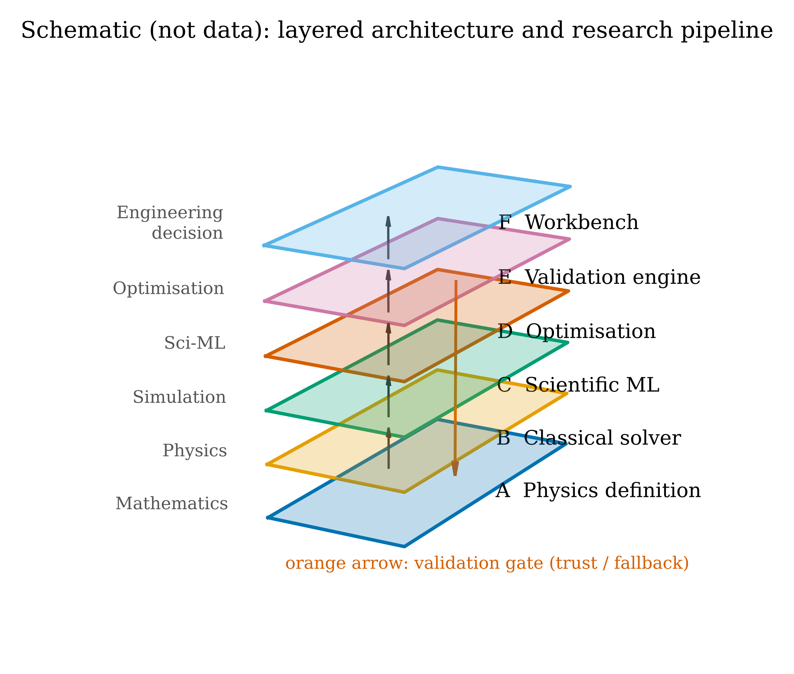
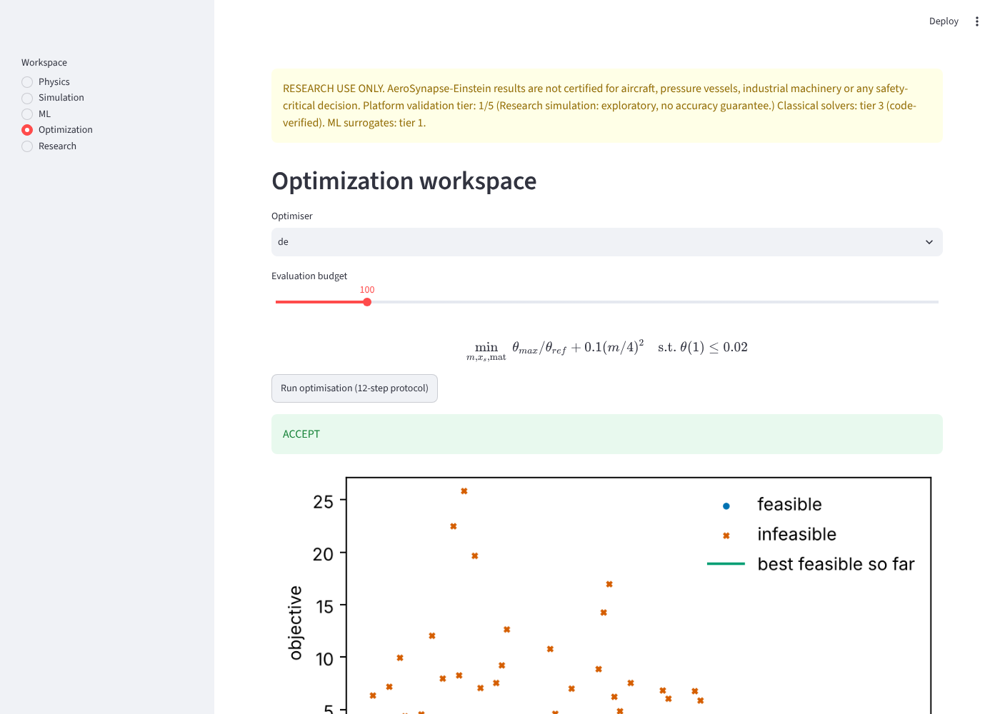
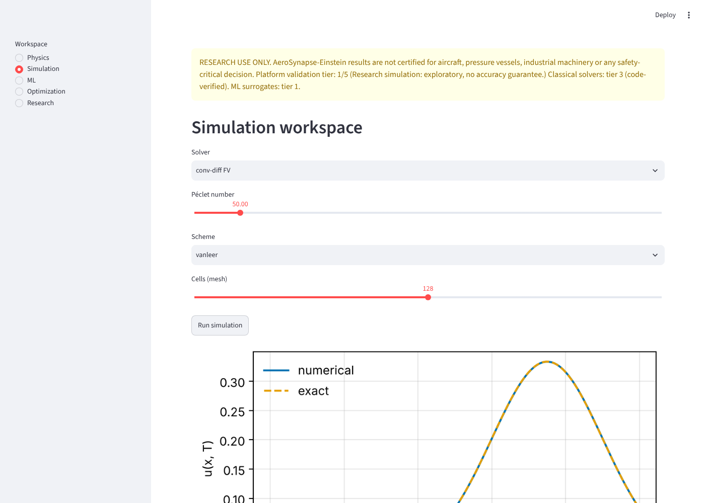
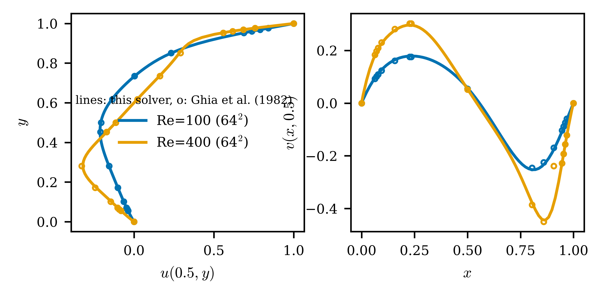
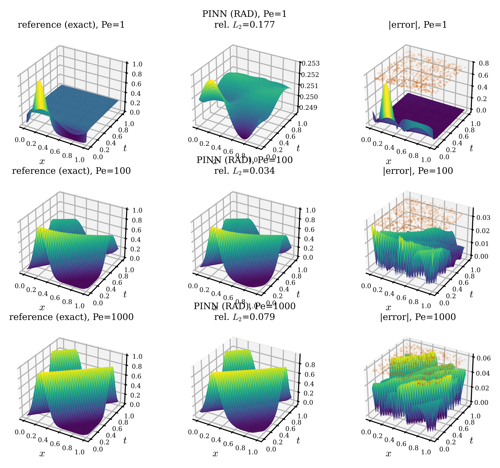

# AeroSynapse–Einstein

<!-- sources: phase1_verification, phase2_pinn_benchmarks, phase3_adaptive_collocation, phase4_operators_uq, phase5_optimization, phase6_fluids_aero, phase7_validation_engine -->

**Physics-aware AI for computational engineering.** This is a Python research platform. It provides
verified PDE solvers, physics-informed neural networks, neural operators, uncertainty quantification and
constrained design optimisation, connected by a validation engine that decides when a learned model may be
trusted and when to fall back to the classical solver.

> **RESEARCH USE ONLY.** Nothing here is certified for aircraft, pressure vessels, industrial machinery or
> any safety-critical decision. Platform validation tier **1/5** (research simulation); the classical solvers
> are tier 3 (code-verified); the ML surrogates are tier 1. See [`docs/VV_REPORT.md`](docs/VV_REPORT.md).

**Scope.** Laminar, mostly 1D/2D problems on a CPU laptop: heat, convection–diffusion, Burgers, wave,
Poisson, 2D incompressible Navier–Stokes, potential-flow airfoils, and inverse and design problems built on
them. **Non-goals:** turbulence modelling, 3D CFD, certified engineering analysis, and any claim that AI
replaces the solver.

## Module maturity

| Area | Implemented | Verified / validated | Experimental |
|---|---|---|---|
| Physics API, BCs (Dirichlet, Neumann, Robin, periodic, initial, interface) | ✓ | MMS for every type | interface: definition only |
| FD / FV / P1-FEM solvers for the 5 Level-1 PDEs | ✓ | observed orders (Phase 1) | |
| 2D Navier–Stokes (MAC projection), all fluid BCs | ✓ | analytic flows, Ghia cavity, DFG cylinder | |
| Panel method, NACA / CST airfoils | ✓ | exact cylinder C_p, lift slope | |
| PINNs, samplers, BC strategies | ✓ | autograd/FD, exact residuals | |
| FNO, DeepONet, POD, hybrids, UQ | ✓ | held-out / OOD / calibration (Phase 4) | |
| Optimisation engine + 12-step protocol, inverse problems | ✓ | analytic optima, KKT, adjoint vs FD | |
| Trust / fallback, resource estimator | ✓ | OOD fallback study (Phase 7) | |
| Streamlit workbench | ✓ | AppTest smoke tests | |
| OpenFOAM adapter, Level-4 plugins, AirfRANS loader | ✓ | | not run (external tools / data) |

## Architecture



Layers: **A** physics definition → **B** classical solvers → **C** scientific ML → **D** optimisation →
**E** validation engine → **F** workbench. See [`docs/guides/architecture.md`](docs/guides/architecture.md).

## Install (Windows 11 first)

```bash
python -m venv .venv
```
```bash
.venv\Scripts\activate
```
```bash
pip install -e ".[dev,torch,ui]"
```
```bash
aerosynapse doctor
```

On Linux/macOS use `source .venv/bin/activate`. Python ≥ 3.10. <!-- audit:ignore (version) --> PyTorch on CPU is enough; CUDA is used when
available.

## 5-minute quickstart

```bash
aerosynapse run configs/workflow_quick.yaml
```
```bash
streamlit run src/aerosynapse/ui/app.py
```

The first command runs define → simulate → train → validate → optimise → report and writes
`results/workflow_quick/report.html`. The second opens the five-workspace workbench.

CLI: `aerosynapse run | train | optimize | validate | report | reproduce | figures | doctor`
(every command prints the research-use banner).

## Reproducing the results

```bash
python scripts/reproduce_all.py --profile quick
```

This runs every phase study, the figures, the paper tables and the claims audit. Measured wall-clock times are
in [`docs/REPRODUCIBILITY.md`](docs/REPRODUCIBILITY.md); full-profile Colab/Kaggle notebooks are in
`notebooks/` (generated, **not executed** by us).

## Result snapshots (all from `results/`, checked by `scripts/audit_claims.py`)

| Result | Value | Artifact |
|---|---|---|
| Observed order, conv-diff FV van Leer (theory 2) | 1.996 | `results/phase1_verification` |
| Lid-driven cavity Re = 400 (64²) vs Ghia et al. (1982), RMS u / v | 0.0036 / 0.0044 | `results/phase6_fluids_aero` |
| DFG 2D-1 cylinder drag C_D (reference 5.5795) | 5.4636 | `results/phase6_fluids_aero` |
| PINN median rel. L2 at Pe = 10 / 1000 (uniform sampling, 8 seeds) | 0.0180 / 0.1793 | `results/phase3_adaptive_collocation` |
| Best adaptive sampler at Pe = 1000 (no significant difference) | 0.1658 | `results/phase3_adaptive_collocation` |
| FNO median error in-distribution / out-of-range Pe | 0.0016 / 0.0885 | `results/phase4_operators_uq` |
| FNO speed-up per query vs FV solver; break-even queries | 35.6×; 955 | `results/phase4_operators_uq` |
| Adjoint identification of α (true 0.1) | 0.1004 ± 0.00083 | `results/phase5_optimization` |
| Fallback rate on out-of-range queries; guarded worst-case error | 1.0; 0.00101 | `results/phase7_validation_engine` |

<p float="left">
  
  
</p>




## Repository map

```
src/aerosynapse/   library (physics, numerics, ml, uq, optim, validation, experiments, ui, plugins, data)
tests/             pytest suite (unit / verification / validation markers)
scripts/           run_phaseN.py studies, reproduce_all.py, make_figures.py, make_report.py, audit_claims.py
results/<id>/      record.json (Section 13 fields), config, metrics.json, history.csv, git hash
docs/              planning document, phase summaries, V&V report, literature, traceability, decisions, issues
paper/             LaTeX source, generated tables, figures (PDF/SVG/600-dpi PNG/HTML), claims audit, readiness
notebooks/         Colab/Kaggle notebooks for full-profile runs and AirfRANS
```

## Honest limitations

See [`docs/KNOWN_ISSUES.md`](docs/KNOWN_ISSUES.md). In short: the core research hypothesis (adaptive
collocation helps at high Péclet under equal budget) was **not supported** in our study. PINNs are far less
accurate and far slower than the classical solvers on every problem studied here. Validation uses published
benchmark tables, not experiments. AirfRANS and OpenFOAM integration exist but were not run.

## Citation and licence

Apache-2.0 ([`LICENSE`](LICENSE)). Cite via [`CITATION.cff`](CITATION.cff). Third-party benchmark data:
Ghia et al. (1982) tables and DFG 2D-1 values with provenance in `src/aerosynapse/data/`.
