# AeroSynapse Studio: user guide

Start Studio by double-clicking **`AeroSynapse.bat`** in the project folder. A splash screen loads the kernel and the
tools; the **start page** then offers a blank design, a new project in a new folder, or a template.

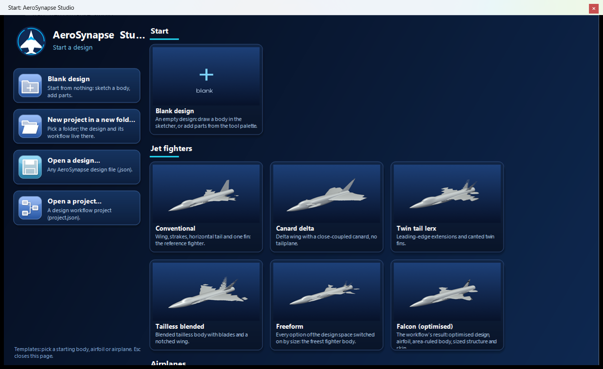

## Starting a design

| Start-page choice | What happens |
|---|---|
| **Blank design** | an empty feature tree: pick the **Sketcher** workbench, a plane, and draw your first body |
| **New project in a new folder** | choose a parent folder and type a name; Studio makes the folder, writes `design.json` and creates the eight-stage workflow project there (`project.json`) |
| **Open a design** / **Open a project** | any design file (`.json`) or a workflow project folder |
| **Templates** | 22 starting bodies in four groups: *Start* (blank), *Jet fighters* (conventional, canard delta, twin tail with LERX, tailless blended, freeform, the optimised Falcon), *Airplanes* (light aircraft, airliner, glider, flying wing, blended wing body, UAV), *Airfoil wings* (NACA 0012, 2412, 4412, biconvex, diamond, the optimised section, the Falcon section) and two showcase designs |

A template opens untitled: save it under your own name with Ctrl+S. The start page returns with the **Start page**
tool of the Start workbench. From a terminal, `python -m aerosynapse.cli workflow new NAME --from design.json
--where PARENT_FOLDER` makes the same project folder.

## The layout and the workspaces

Studio is laid out like a CAD program: a ribbon along the top, the model tree on the left, and a clean 3D view.

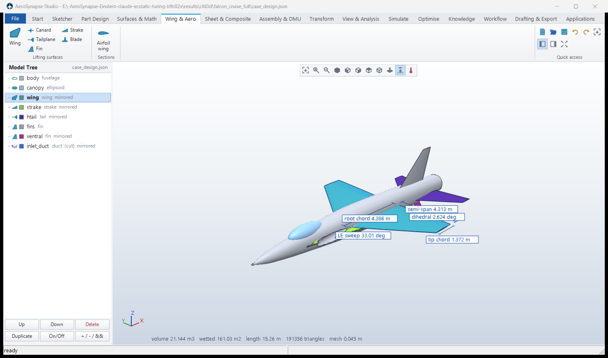

| Area | What it is |
|---|---|
| **Ribbon** (top) | **File** (blue, at the left) holds every menu. Then one tab per workbench (Start, Sketcher, Part Design, Surfaces & Math, Wing & Aero, Sheet & Composite, Assembly & DMU, Transform, View & Analysis, Simulate, Optimise, Knowledge, Workflow, Drafting & Export, **Applications**). Below the tabs, the workbench's tools in named groups: the main tool of a group is a large button, the others small buttons with their names. The mouse wheel over the ribbon walks through the tabs. **Quick access** at the right: new, open, save, undo, redo, fit, and the switches for the tree, the property panel and the full 3D view |
| **Model tree** (left) | every part in order, with its type icon, its colour swatch, its name and type; cuts and mirrored parts are marked, hidden parts greyed. Click to select, double-click to edit, right-click for the part menu. Up, Down, Delete, Duplicate, On/Off and add / cut / intersect below |
| **3D view** | left drag orbits, right drag pans, the wheel zooms. **Click a part to select it** (its dimensions appear on it), **double-click** to edit it with live preview, **right-click** for its menu. The axis triad in the corner turns with the view |
| **View toolbar** (floating over the 3D view) | fit, zoom in, zoom out, isometric, front, side, top, shaded / wireframe, section, dimensions on / off, part colours |
| **Properties** (right, off by default) | every parameter of the selected part with its unit, and its JSON: switch it on with Quick access or F3 when you want the raw values |

### Parts in colour, materials and sections

Every part is drawn in its own colour, as the parts of an assembly are in a CAD program, with dark edges:

* **by part** (default): a part's appearance if set, else its material's colour, else a distinct colour per part;
* **by material**: aluminium alloys light grey, titanium dark grey, steels and Inconel steel grey, carbon composites
  charcoal, glass fibre green, ceramic matrix beige;
* **single colour**: one neutral grey.

Right-click a part (in the 3D view or the tree) for **Material** (the structural materials of the analyses: Al 7075,
Al 2024, Al-Li, Ti-6Al-4V, Ti-6242, Inconel 718, steel 300M, carbon/epoxy IM7, carbon/BMI, glass/epoxy, C/SiC) and
**Appearance** (aluminium, steel, titanium, carbon, glass fibre, ceramic, purple, violet, teal, green, magenta, blue,
orange, red, gold, white, glass). Both are saved in the design (`material`, `appearance`); the material is the one the
structural analyses use.

**Section view** (C, or the view toolbar; X, Y, Z pick the plane): the model is cut, and where the cut opens a part
its cut face is drawn flat in a darker shade of that part's colour, so each part's section reads as a solid of its own.

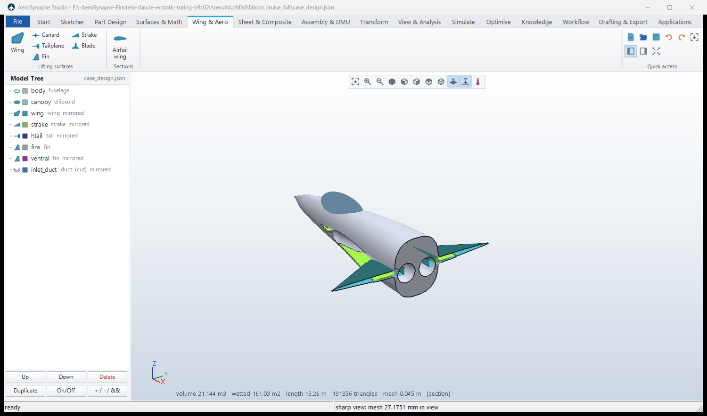

### Dimensions one click away

Click a part: its driving dimensions appear on it as dimension lines with values. Wings, canards, tails, fins,
strakes and blades show semi-span, root chord, tip chord, leading-edge sweep and dihedral on their real edges (on the
side facing you when the part is mirrored); spheres, ellipsoids, boxes, cylinders, cones and tori their sizes; any
other part its length, width and height. **Click a value, type the new one and press Enter**: the part rebuilds at
once (Ctrl+Z undoes). The view toolbar's dimensions button switches them off and on.

### Preview before every action

* **Modelling tools** open the feature pad: every parameter, previewed live in the 3D view; OK keeps, Cancel restores.
* **3D flow setup**: while the form is open, the 3D view shows the computational domain (blue), the refined core with
  its cells (orange), the free-stream direction from the angle of attack and sideslip (green) and the probes (red), and
  states the grid the solver will build (domain size, cell size, number of cells, half or full model). It follows
  every change in the form.
* **Wing optimisation setup**: the main wing as it is (dark) and at the low and high end of every planform variable
  that is varied (sweep orange, taper green, span purple).
* **Applications**: picking an entry shows its command and description in the task window first; nothing runs until
  Run.

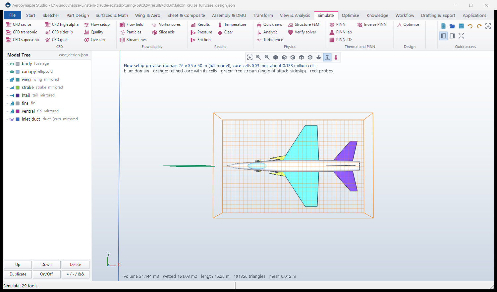

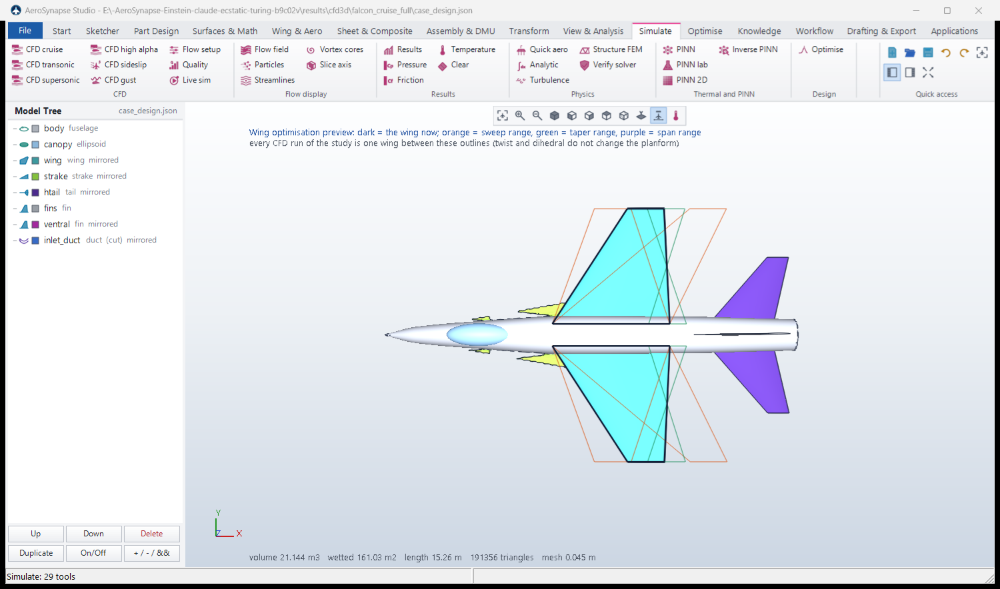

### Applications: all of AeroSynapse-Einstein in the workbench

The **Applications** tab holds every runnable part of the project, 129 entries in 15 groups, generated by
`scripts/make_app_catalog.py` into `assets/app_catalog.json` from the command line, the research scripts, the thermal
PINN experiments and the local web apps:

| Group | Entries |
|---|---|
| Aircraft design | design workflow, whole-aircraft and fighter studies, quick aerodynamics, surrogates |
| Aerodynamics and CFD | 3D flow of the design, verification suite, turbulence, analytic solutions, speed benchmark, mesh study, fighter CFD |
| Shape and wing optimisation | CFD wing optimisation, CMA-ES airfoil and wing shape (quick and standard), topology, XFOIL check, verification, trust split |
| Structures | wing box sizing, FEM and flutter, composite laminate, clash |
| Thermal and PINN | skin heating, PINN simulation of the design |
| Local apps | Aircraft Designer, THERMAL LAB, the thermal results app (in the browser) |
| PINN phase 1 to phases 6-10 | every experiment of the thermal PINN research project, phase by phase (verified solvers, data, 1D and 2D PINNs, inverse problems, analysis, visualisation, interface, real data) |
| Research pipeline, Reports and audits, Export | the phase runners, reproduction, figures, reports, claims audit, CAD package |

Click a group to list its entries; the one you pick opens in the task window with its command (editable) and
description. Commands with `{design}` use the design open in Studio. The local apps keep running until Stop. The web
apps open in the browser; they cannot be embedded in the native window (the 32-bit MinGW build has no web view).

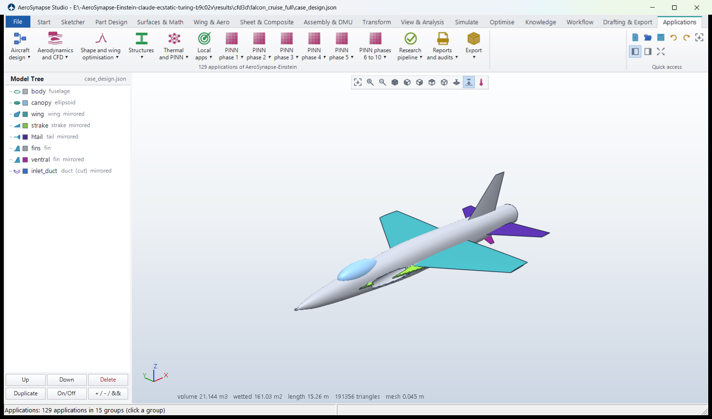

| Key | Workspace switch |
|---|---|
| **F2** | model tree on/off |
| **F3** | properties on/off |
| **F11** | full 3D view: hides the panels, again brings them back |
| **F9** | the design workflow window |
| **C**, **X**, **Y**, **Z** | section view, and its plane |

### Preferences

*Help > Preferences* (or the Preferences tile of the Start workbench):

| Setting | Choices |
|---|---|
| Charts and reports | **Plain** (default: white paper, thin dark lines, muted colours, no glow) or Dark (bright colours on dark blue) |
| 3D display | **Calm** (default: no glowing pulses, softer streamlines and particles) or Vivid |
| Tool bar | kept for older settings files; the ribbon replaced the sliding tool bar |

They are kept in `settings.json` in the project folder, which the analyses read too.

## The workbenches

| Workbench | Tools |
|---|---|
| **Start** | start page, blank design, new project in a new folder, open design, save, workflow |
| **Sketcher** | sketch on the **XY**, **XZ** or **YZ** plane; polyline / spline, rectangle, circle, slot; revolve, extrude and loft sketches |
| **Part Design** | **Pad**, **Pocket**, **Shaft**, **Groove**, Rib, **Slot**, **Hole**, Fillet, **Chamfer**, Shell, **Draft**, Mirror, Pattern; fuselage, sphere, ellipsoid, box, cylinder, cone, torus, capsule |
| **Surfaces & Math** | revolve, extrude, loft, Bezier sheet, swept duct, equation f(x,y,z) ≤ 0, superellipsoid, parametric sweep, lattice, half-space; **zebra** and **curvature** checks |
| **Wing & Aero** | wing, canard, tailplane, fin, strake, blade, wing from any airfoil |
| **Sheet & Composite** | **bent plate** (sheet metal with bend radius), **unfold** (flat blank, K = 0.44), **laminate** (classical lamination theory), lattice infill, thin wall |
| **Assembly & DMU** | **clash** analysis, **space reservation** volumes, **kinematics** (animated pivot joints), joint, **pipe** and **harness** routing |
| **Transform** | mirror, pattern, twist, taper, bend, shear, stretch, pivot rotation, clear, duplicate, add/cut, delete, undo, redo |
| **View & Analysis** | isometric, front, side, top, fit, full 3D, tree, properties, wireframe, sections in x, y and z, **3D dimensions** (MBD), zebra, curvature, mesh resolution, mass properties, design check |
| **Simulate** | quick aerodynamics; **full-3D CFD** at cruise, transonic, supersonic, high incidence, **sideslip** and **gust**; quality (live, draft, standard, fine); **live simulation**; flow field, particles, streamlines, vortex cores, slice axis; analytic, PINN, structure FEM; colour by pressure, friction or temperature; results; PINN lab, PINN 2D, inverse PINN, solver verification |
| **Optimise** | optimisation centre, airfoil shape, XFOIL check, topology, fighter and aircraft studies, surrogate, wing sizing |
| **Knowledge** | **skeleton** parameters (top-down design: change the design variables, the geometry is rebuilt), **RFLP** traceability, design **rules** check |
| **Workflow** | the workflow window (F9), new and open project, run all, and each of the eight stages |
| **Drafting & Export** | A3 drawing and CAD package (STEP, glTF, STL, OBJ, DXF), STL, OBJ, SVG section, save as, the project report as **PDF**, **Word**, **text** or web |

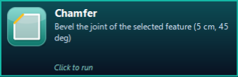

The icons (171) are drawn by `scripts/make_icons.py` from the tool table `cpp/studio/tools.inc`.

### Where the CATIA and Creo functions are

| CATIA / Creo function | In AeroSynapse Studio |
|---|---|
| Sketcher (planes, lines, rectangle, circle, slot) | Sketcher workbench: pick the plane, then the shape; live segment length and angle, Shift for horizontal / vertical, snap |
| Part Design: Pad, Pocket, Shaft, Groove, Slot, Hole / Creo Extrude, Revolve, Hole | Part Design workbench (from a sketch on any plane, with an offset) |
| Rib, Sweep / Creo Sweep, Blend | Rib, swept duct, parametric sweep, loft |
| Fillet, Chamfer, Shell, Draft | feature modifiers `blend`, `chamfer` (45° bevel at a join), `shell`, `draft` (degrees, on an extrude) |
| Wireframe and surface design; G0–G3 continuity checks | curves and Bezier sheets; zebra (reflection lines) and curvature colouring |
| Generative Sheet Metal (bend, flange, unfold) | bent plate (flanges with a bend radius) and unfold to the flat blank |
| Advanced Composites (ply layup) | laminate: A, B, D matrices, effective moduli, polar stiffness plot, ply stack |
| Assembly constraints, clash analysis | feature tree with pivots and patterns; clash analysis of every pair of solids, with litres of overlap |
| DMU kinematics, space reservation | kinematics animates every pivot joint; reservation boxes are checked by the clash analysis |
| Electrical harness, piping | harness and pipe routes (smooth ducts along a path) |
| Knowledgeware (rules, checks) | design rules evaluated on measured values (volume, span, static margin, wave drag...); put your own under `"rules"` in the design file |
| Systems engineering (RFLP) | RFLP traceability: requirements, functions, logical blocks and physical features of a workflow project |
| Top-down / skeleton design | skeleton parameters: the fighter design variables drive the geometry |
| Simulation Live | live simulation: a quick 3D flow re-runs after every edit |
| Generative design, additive (lattice) | topology optimisation; gyroid, Schwarz P, diamond and strut lattices and lattice infill |
| Mechanism dynamics | kinematics of pivot joints (no dynamics solver) |
| MBD 3D annotations | 3D dimensions in the view |
| Generative drafting, BOM | A3 drawing, DXF three-view and bill of materials in the export stage |

## The feature pad: every tool, with a live preview

Every tool that adds or changes a feature works as before (it acts at once) and then opens its **pad**: all the
feature's parameters with their units, grouped as *Shape*, *Position* (move, rotate, scale, mirror) and *Join*
(operation, on/off, fillet, chamfer, shell, draft). **Every change is previewed in the 3D view as you type**;
**OK** keeps it, **Cancel** puts the design back exactly as it was before the tool. Double-click a feature in the
tree to open its pad later. *Place at picked point* moves the feature's origin to a point you click on the model
(right-click cancels picking). The properties panel on the right still works as before.

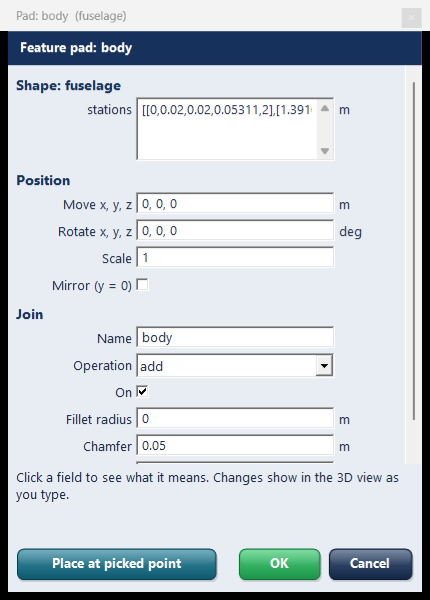

### Holes in any direction

The **Hole** tool's pad has its own section:

| Field | Meaning |
|---|---|
| Diameter | hole diameter, m |
| Through all / Depth | right through the model, or to a depth from the entry point |
| Entry point | where the drill enters: typed as x, y, z or **picked on the model** |
| Direction | -z (down), +z, -y, +y, -x (forward), +x (aft), or a **custom vector**; picking a point fills the vector with the surface normal, so the hole is drilled square into the surface |
| Edge chamfer | a 45-degree bevel round the hole's edge |

A new hole starts on the top surface in the middle of the model, drilled downwards. *Pick entry point on model*,
then click the surface: the point and the inward normal are filled in and the preview shows the hole there.

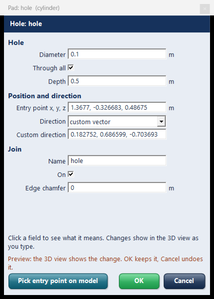

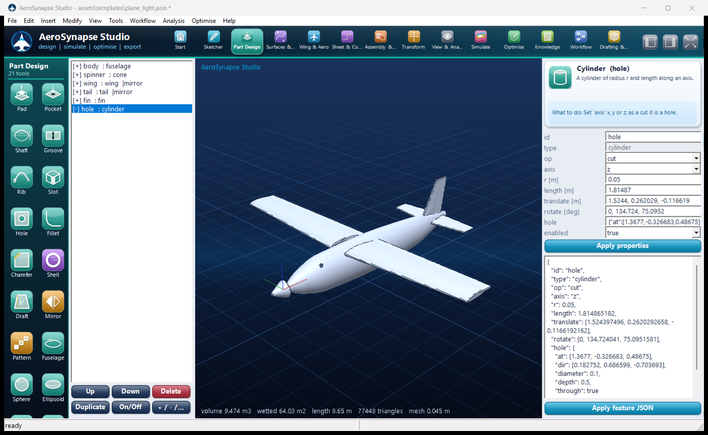

## Clean surfaces and sharp lines at any zoom

* **Exact surfaces.** Wings, canards, tails, fins, strakes and blades, fuselages, revolved bodies (nacelles,
  spinners), spheres, ellipsoids, cylinders and cones are drawn straight from their definitions as structured
  surfaces (rows and columns of points, line-to-line connectivity, exact normals), so they look finished at any
  zoom; *Wireframe* shows their grid. They match the kernel's shape to rounding precision (largest distance 2e-8 m on
  the templates). A part is drawn this way unless a later cut reaches its visible surface, or it is hollowed,
  deformed (twist, taper, bend, shear, stretch) or of another kind; those parts use the sampled mesh, which shows the
  cut. Fillets between parts are not drawn on exact surfaces (the parts meet with a sharp junction).
* **True edge lines**: leading and trailing edges, roots, tips, flat ends and section corners.

* For the sampled parts, when the view stops moving after a zoom, Studio **re-meshes what is in view at the screen's resolution** (down to
  about a millimetre; the status bar shows the spacing), so close-ups stay sharp.
* Big designs use a coarser sampled grid (about 12 million cells at most, shown as *mesh* in the status line) so they fit in memory.
* On the sampled mesh, wings, fins and tails are never drawn thinner than about one mesh cell, and sheets, plates, lattice walls and
  shells thinner than 1.5 cells are drawn that thick, so thin trailing edges and sheet-metal parts no longer break
  into a sawtooth or vanish. This is for the editor's picture only: exports, volumes in reports and every analysis
  use the true geometry.
* The selected feature is shown with a light tint instead of a wire mesh.
* A soft shadow lies on an invisible floor under the model (several jittered projections through the stencil buffer),
  the material has a metallic sheen and the view's name (*Isometric*, *Front*, ... starred when turned away) sits above
  the axis triad. G (or View > Floor shadow) turns the shadow off.

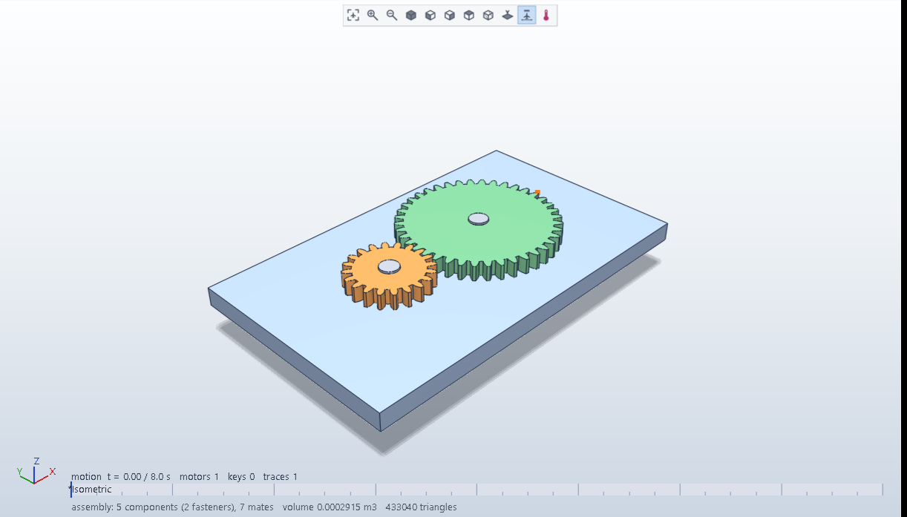

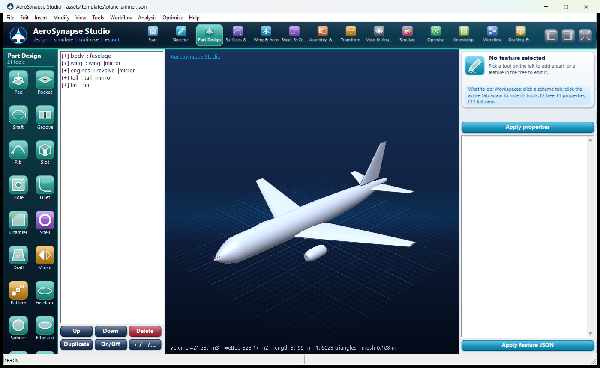

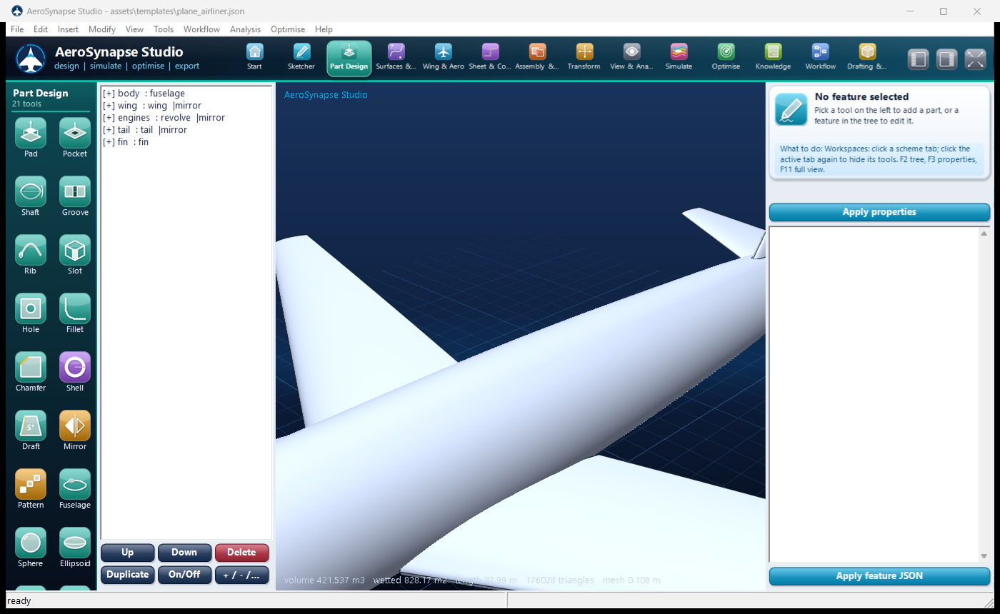

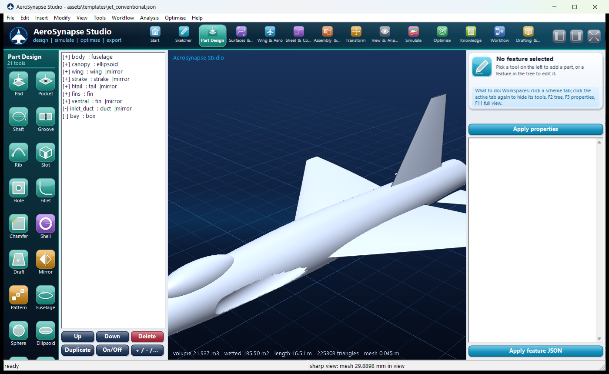

* **Sharp cuts (2026-11-22).** The sampled mesh is built by **dual contouring** (Ju et al. 2002, with a truncated
  solve): each vertex sits where the surface's tangent planes meet, so hole rims, slot corners and chamfer edges are
  sharp and straight instead of rounded and wobbly, and the crease lines along them are clean. Along the edges the
  mesh is split so each face keeps its own shading. On a 1 x 0.6 x 0.3 m block with two holes and a slot the volume
  at a 4 mm mesh is within 0.002 % of the exact value and the top face is exactly flat (plain surface nets: up to
  6.6 mm off at a 45 mm mesh). `AEROSYNAPSE_SURFACE_NETS=1` restores the old mesher. The close-up mesh now also
  replaces the coarse one on the model's own outer faces (before, the coarse top face and its polygonal hole rims
  were drawn over the fine mesh).

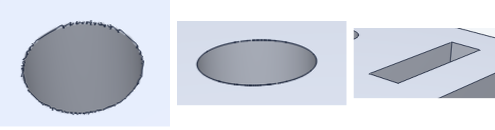

## Assemblies: parts, fasteners, mates and motion

*Assembly & DMU* tab. An assembly is a document of **components** (part designs, each placed by a rigid pose and
meshed once, so moving them is instant) and **mates** between their faces.

* **Start**: *New assembly*, *From design* (the open design becomes the first part) or *Example* (a base plate with a
  shaft in its bore, an arm on the shaft, four M8 bolts and a motion study). The first component is fixed (the
  ground); right-click a component to fix or float it, hide, duplicate, open its part file or delete it.
* **Insert part** adds a part design file. **Fasteners** come from an ISO metric library, M3 to M20: hex bolts
  (ISO 4017, with a cosmetic thread), socket head cap screws (ISO 4762), hex nuts (ISO 4032), washers (ISO 7089),
  dowel pins and shafts. Type the size, for example `M8x30`.
* **Mate**: click a face on one part, then a face on another. Studio recognises what you clicked: a flat face (its
  plane), a round face (a hole or a shaft: its axis and diameter, shown in the status bar) or a point, and offers the
  mates that fit: coincident, concentric, distance, angle, parallel, perpendicular, lock, insert. Mates are listed in
  the tree; right-click one to change its value, flip it, suppress it or delete it.
* **Insert into hole**: click a fastener's shank, then the hole. The fastener goes in concentric with the hole and
  seated on its face, the way it already faces (a bolt pointing up comes in from the top).
* **Moving parts**: Shift + drag moves the part under the mouse, Ctrl + drag turns it; the mates hold. A part on a
  shaft or in a hole turns about that axis, and what is mated to it follows. Undo restores every step.
* **Exploded view** (*Explode*, or E): fasteners slide out along their axes, parts on shafts slide off them, the rest
  move apart; dashed lines show where each part belongs. Click again to put it back together.
* **Motion study**: *Motor* (click a round face of the part that turns; 90 deg/s), *Key pose* (move parts, then store
  their positions at a time; the motion between keys is smooth), *Trace path* (click a point: its path is drawn while
  it moves), *Play* (or Space) and *Reset*. The timeline under the view shows the time and the keys; click or drag on
  it to scrub.

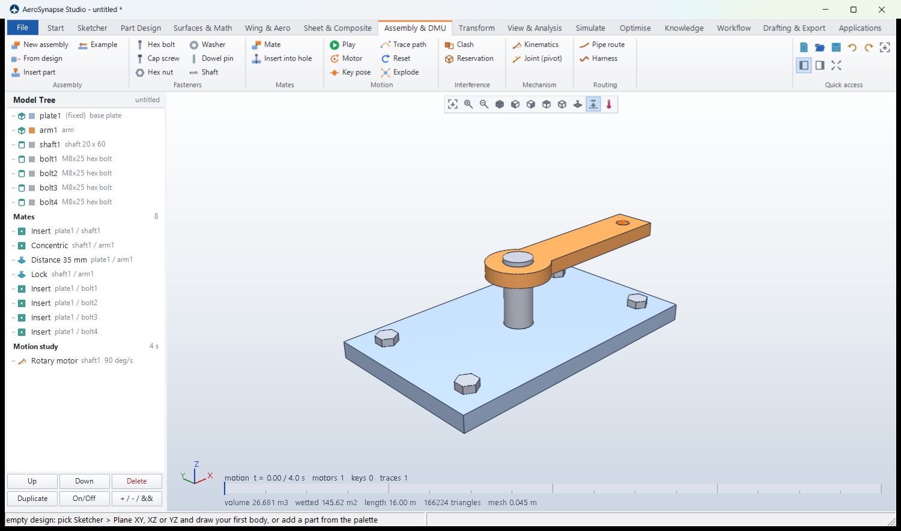

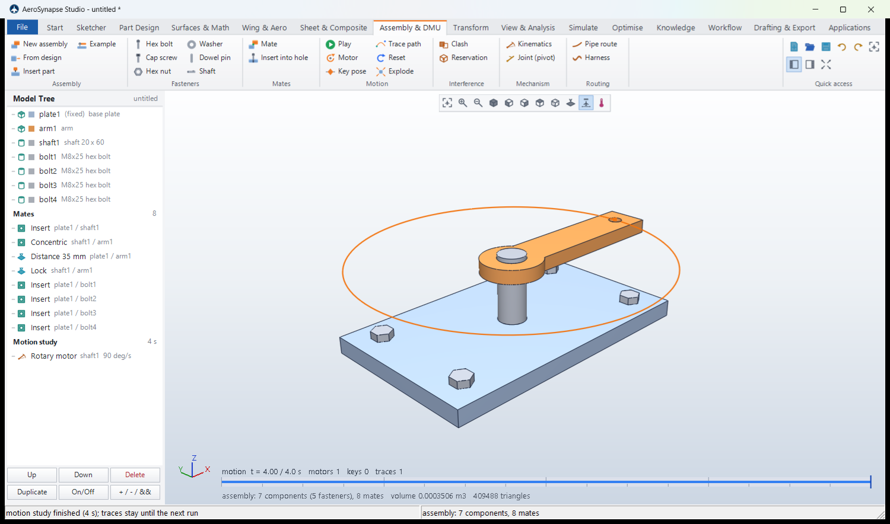

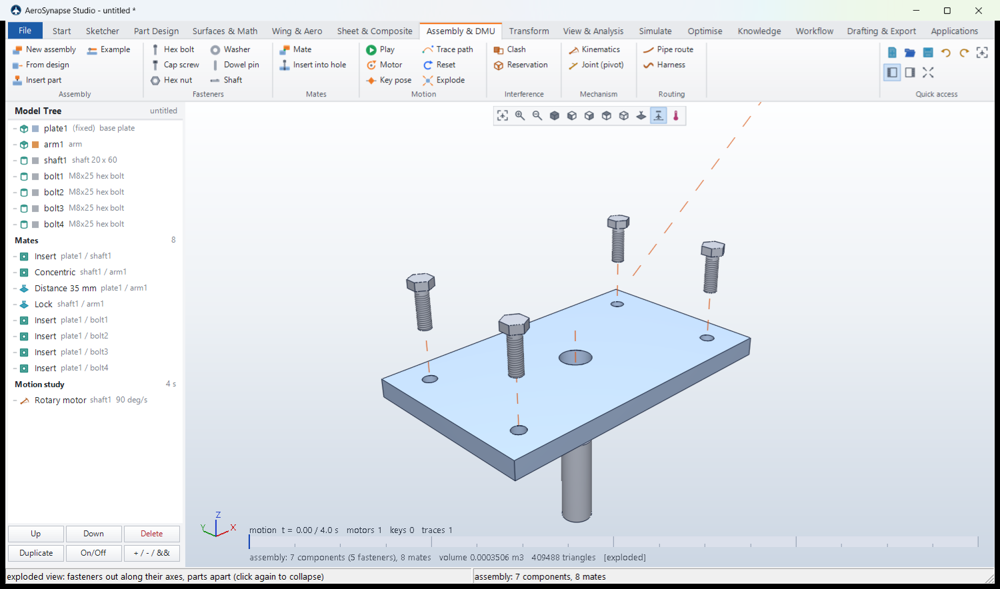

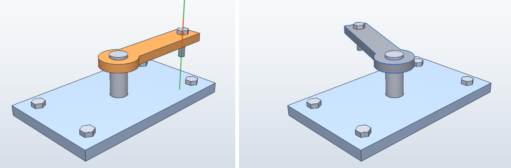

* **Gears**: *Spur gear* makes an involute spur gear (20 deg pressure angle) from its module, teeth, face width and
  bore (for example `m2 z20 b8 d10`). It is a kernel feature of its own (`"type": "gear"`), so a part design can use
  it too; it meshes in about a second whatever the number of teeth, and its volume is within 0.02 % of the exact
  outline. *Gear mate*: click two gears; their teeth are lined up so they mesh, and from then on the second turns
  with the first by the tooth ratio (the other way round for outside gears), over any number of turns. Studio warns
  when the centre distance is not m (z1 + z2) / 2 or the modules differ. *Gear train* is a worked example: a
  20-tooth pinion with a motor drives a 40-tooth gear at half speed; the trace on the gear's tooth tip closes into
  one circle after 8 s.
* **Sub-assemblies**: *Insert part* also takes an assembly file. It comes in as one rigid component (its parts where
  its own mates left them), drawn in its parts' colours and marked *[sub-assembly, N parts]* in the tree. Its faces
  can be picked for mates (a hole or shaft inside it is recognised in the sub-assembly's frame), and it moves,
  explodes and animates as a unit. Sub-assemblies may contain sub-assemblies; component files are found relative to
  the assembly's folder.

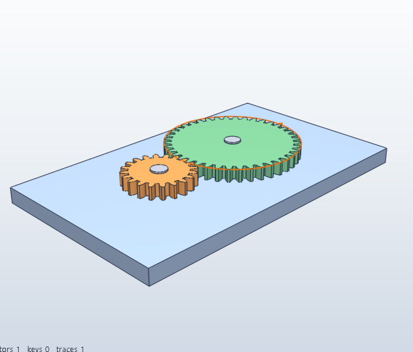

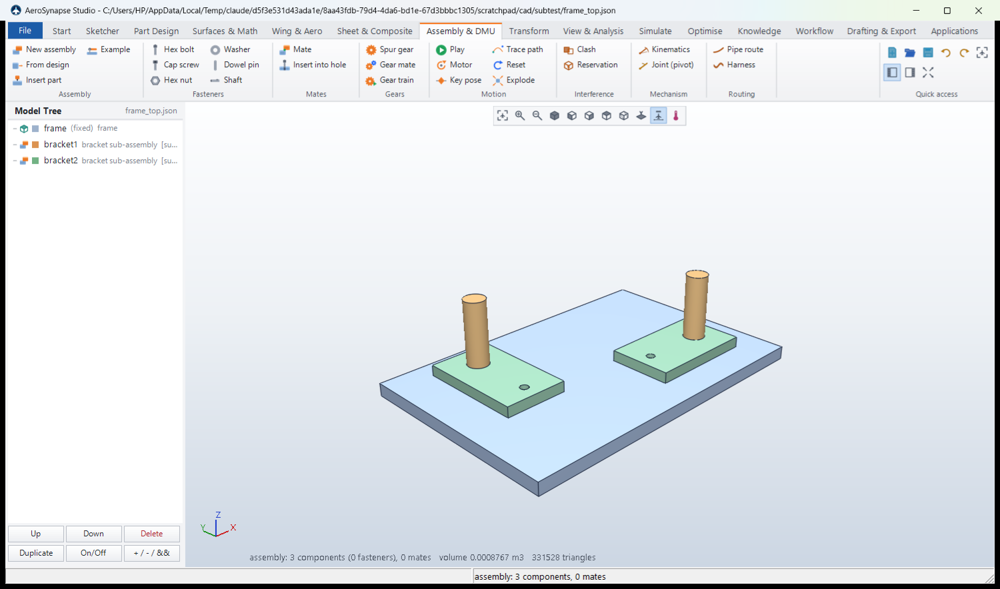

* **Helical, bevel and rack gears**: *Helical gear* (normal module, teeth, width, bore, helix angle; negative for
  a left hand: an outside pair needs equal and opposite angles), *Bevel gear* (straight teeth; module at the large
  end, pitch cone angle; 45 deg for a 1:1 pair at 90 deg) and *Rack* (module, number of teeth, width, bar depth).
  They are kernel features (`"type": "gear"` with `"helix"` or `"cone"`, and `"type": "rack"`); their volumes are
  within 0.03 % of the exact values (helical: the transverse outline times the width; bevel: sections scaled towards
  the apex; rack: bar plus trapezoid teeth). *Gear mate* works for any pair: parallel axes (spur, helical), crossed
  axes (bevel) and a gear with a rack (the rack slides one pitch radius per radian). The turning sense comes from
  the speeds at the contact point, the teeth are phased to mesh, and Studio notes a wrong module, helix hand, bevel
  axis angle, centre distance or pinion-to-pitch-line distance. *Gear examples* shows a 20:30 helical pair, a 1:1
  bevel pair at 90 deg on an upright and a rack and pinion, each with a motor.

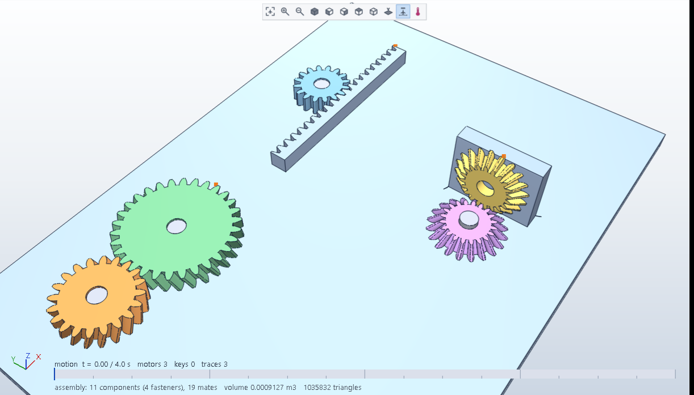

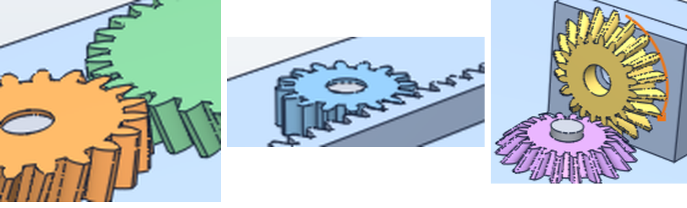

Limits: the mate solver applies one constraint at a time until all hold (it settles bolted joints, shafts, hinges,
arms and gear pairs; it does not report over-constrained sets); sub-assemblies are rigid (their own mechanisms do
not move inside a parent); no worm, spiral bevel or internal (ring) gears yet; threads are drawn, not
modelled.

## Mechanisms: drive parts, interference, power flow

The *Mechanisms* tab gathers what makes things move.

* **Drive parts**: deep groove *ball bearings* (ISO 6000 and 6200 series, rings and balls), bronze *flanged bushings*,
  *keyed shafts* with a DIN 6885 keyway, the matching parallel *keys*, keyed *sleeve couplings* and *rollers*. Gears can
  have their faces recessed round a hub and a splined bore (`r1 s6` in the size, as in the picture of a SolidWorks
  gear). A *roller mate* is a friction drive: the follower turns by the ratio of the two radii.
* **Interference**: every pair of parts whose boxes overlap is sampled with both parts' exact shapes; the report lists
  the pairs that overlap (with the overlapping volume, shown as red points in the view) and those that only touch, and
  classes every shaft-in-hole fit by its diametral clearance: loose (running), sliding, transition (line to line) or
  interference (press). Meshing gears that are in phase touch without overlapping.
* **Power flow**: give each motor its speed and power. The speeds follow the locks, gears (by their teeth), racks and
  rollers (by their radii, 2 % creep); the power passes from part to part less the bearing friction (rolling bearings
  mu 0.0015, bushings 0.08 lubricated), the drag of turning parts in the medium (the submerged share churning the
  oil), the gear meshes (98.5 % spur and helical, 97 % bevel and rack, lubricated) and roller creep; a roller drive
  that must pass more torque than its traction (mu x preload x radius) is flagged as slipping. The report gives every
  part's speed, torque and power, the losses and the efficiency, and the view labels each moving part.
* **Oils**: hydraulic oil ISO VG 32 and gear oil ISO VG 220 join engine oil (viscosity from their grade at 40 and
  100 C); an oil bath is the liquid surface of the environment (the drive-train example fills it to the shafts).
* **Drive train** example: a cast-iron frame with three shafts in six 6004 bearings, a 20:40 gear pair with hubs, and a
  70/50 mm roller drive with a rubber-tyred follower, in gear oil up to the shafts; 20 W at 60 rpm in, 18.91 W out
  (94.5 %: hand 0.985 x 0.96 = 94.6 % less bearing and churning losses); the interference check finds the intended
  contacts and no overlap (it found a real one while the example was built: the output shaft cut 70 mm3 into the big
  gear's teeth until the rollers were enlarged).

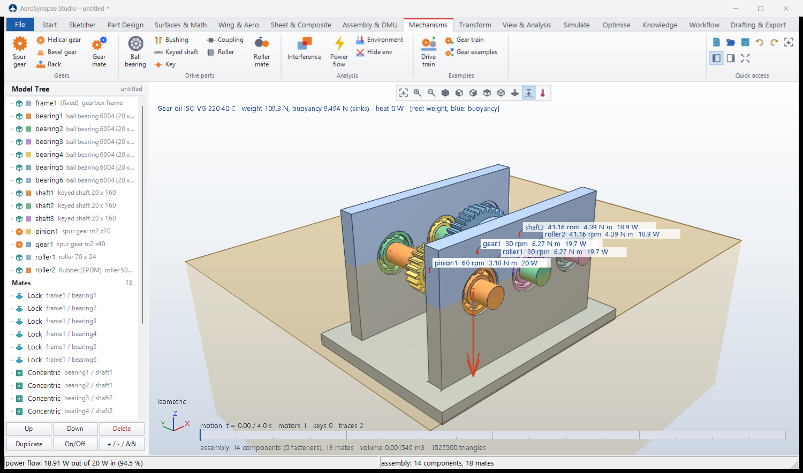

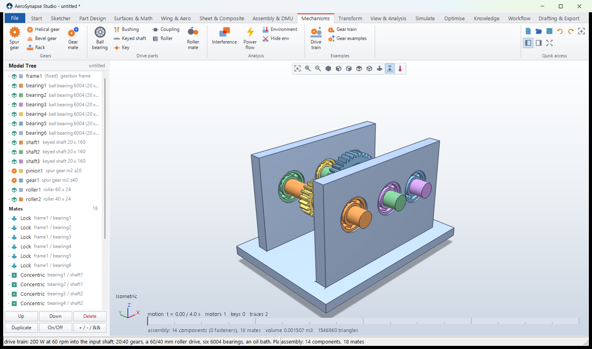

### Belts and chains

* (The flow examples *Vortex street* and *Mixing tank* sit in the Examples group here; the flow tools on the Simulate tab.)
* **Pulley**: a V-belt pulley with SPZ grooves (9.7 mm wide at the rim, 38 deg, 11 mm deep, the pitch line 2 mm under
  the rim), one to six grooves, a web between the hub and the rim on the larger sizes; aluminium by default. Size:
  `D100 d20 g1` (pitch diameter, bore, grooves).
* **Sprocket**: a roller-chain sprocket for ISO 606 chains 06B, 08B, 10B, 12B and 16B: roller seats of radius
  0.505 d1 + 0.069 d1^(1/3) on the pitch circle p / sin(180 deg / z), flanks widening to the tip, a hub on one side.
  Size: `08B z18 d20`.
* **Belt drive** and **Chain drive**: click the driving wheel, then the driven one. The belt or chain is drawn round
  both wheels where they are and runs with them (a black SPZ belt with printed marks; a chain of rollers, inner and outer
  link plates and pins, every roller in a seat). The second wheel turns the same way, by the ratio of the pitch
  diameters (belt) or of the teeth (chain). Making the mate reports the belt's pitch length and wrap, or the chain's
  number of links, the centre distance that would give a whole number of links, and the speed ripple of a small
  sprocket; it warns when the axes are not parallel, the wheels are out of line, a pulley is under 63 mm or the wrap
  under 120 deg.
* **Power flow** through them: a V-belt passes 95 % and creeps 1.5 %; it slips when the pull it must give exceeds
  2 (T0 - m' v^2)(e^(mu' a) - 1) / (e^(mu' a) + 1) (Euler-Eytelwein with the wedge, mu' = mu / sin 19 deg, mu 0.25 dry
  and 0.10 oily, a the wrap, T0 the static strand tension set in the Power flow form, m' 0.07 kg/m). A roller chain
  passes 98 % lubricated, 96 % dry; its pull is checked against the ISO 606 breaking load (a warning under a safety of 7).
* **Belt & chain** example: an SPZ belt from a 63 mm to a 125 mm pulley (200 mm apart) and an 08B chain from 12 to
  24 teeth (44 links, the centre distance found for a whole number of links), on stainless shafts in 6004 bearings on a
  cast-iron plate, each driven with 20 W at 60 rpm. Power flow: the belt is 700 mm long (hand 2C + pi(D1 + D2)/2 +
  (D2 - D1)^2/4C = 700.1 mm), wraps 162 deg, pulls 101 N of the 398 N it can hold at 250 N tension, 29.79 rpm out
  (95 %); the chain runs at 30 rpm, pulls 131 N (safety 137), with 3.4 % speed ripple (1 - cos 15 deg), 96 % dry.

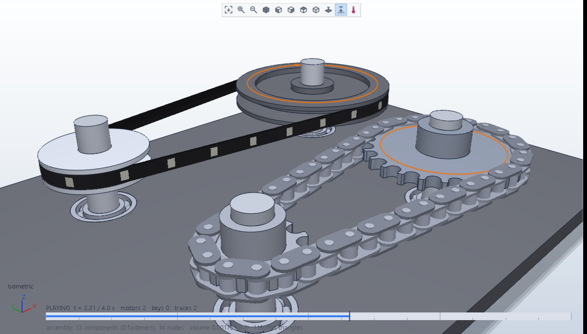

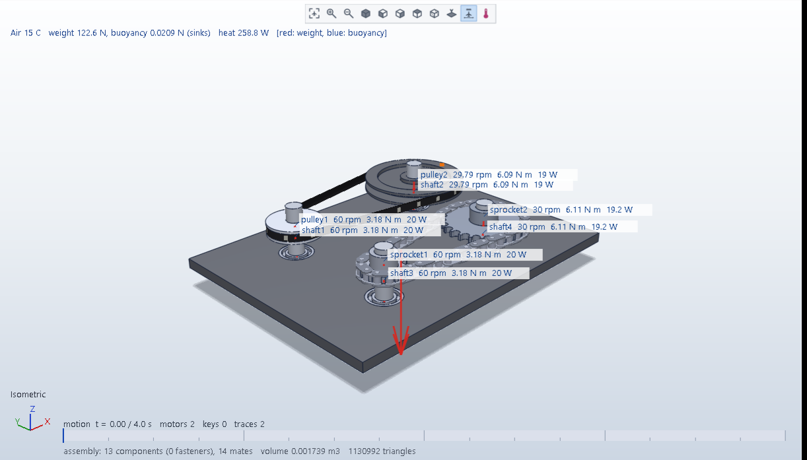

### Worm gears

* **Worm**: a ZA worm (straight-sided threads in the axial section, 20 deg), one to four starts, the diameter factor
  q (pitch diameter = q x module), right or left hand; a new `worm` feature of the CAD kernel. Size: `m4 z1 q10 b50 d20
  h1`.
* **Worm wheel**: a bronze helical gear with the worm's lead angle and hand (its transverse module is the worm's axial
  module), its blank raised and throated by the torus the worm sweeps round it, so the tips wrap the worm.
* The **gear mate** takes a worm and its wheel at 90 deg: the ratio is starts : teeth, the sense follows from the hand,
  and the wheel is turned so a tooth sits in the worm's thread gap. It warns about axes not at 90 deg, the wrong centre
  distance, a wheel cut for another worm and opposite hands.
* **Power flow**: efficiency tan g / tan(g + phi') with phi' = atan(mu / cos 20 deg) and mu from the sliding speed
  (AGMA, hardened steel on bronze, lubricated; 0.15 dry); back-driving efficiency tan(g - phi') / tan g, and
  *self-locking* when the lead angle is under the friction angle (the wheel cannot turn the worm).
* **Worm drive** example: a one-start worm (m4, q10, right hand, 5.71 deg lead) drives a 30-tooth bronze wheel in
  6004 bearings: 120 rpm in, 4 rpm out, 50 W in, 29.1 W out (58.2 %; hand: tan 5.71 / tan 9.75 = 0.582 at mu 0.066,
  the sliding speed 0.25 m/s); it back-drives at 29 %. The interference check finds the worm and wheel touching with
  no overlap.

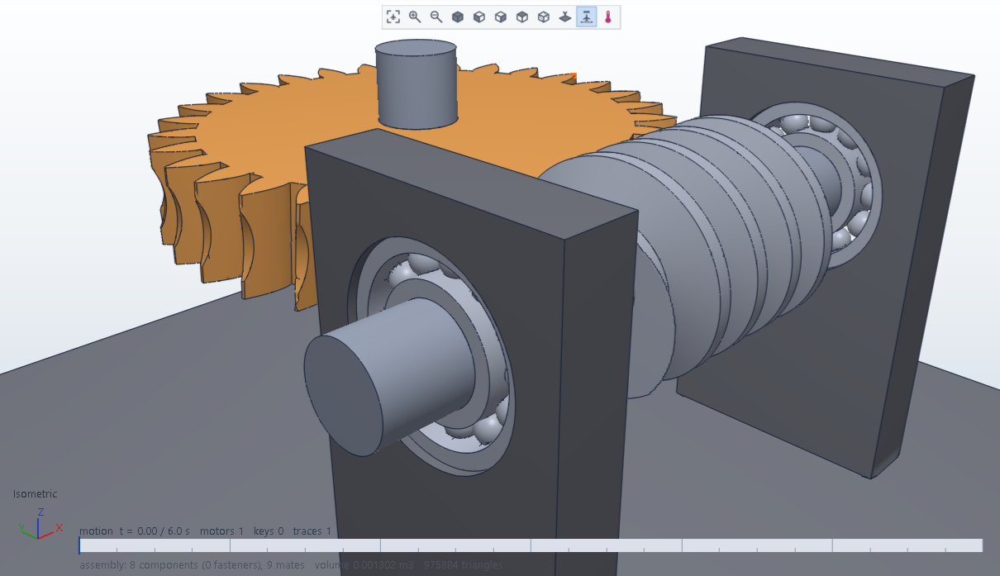

### Cams

* **Disc cam**: the outline is cut from a motion law: cycloidal (no jerk spikes), harmonic, 3-4-5 polynomial or
  uniform velocity, over a rise, a dwell, a return and a dwell, for a roller follower (with an offset) or a flat face.
  Inserting it reports the largest pressure angle (over 30 deg the follower jams), the smallest radius of curvature and
  undercut (the pitch curve bending tighter than the roller, or a flat face needing a cusp). Size: `cycloidal R25 h15
  rise120 dwell60 return120 roller8 e0 b14 d20`.
* **Follower**: a roller in a fork, or a flat face, on a stem.
* **Cam mate**: click the cam, then the follower (placed beside it): the follower's line runs from the cam's axis
  through it, and the follower rises and falls with the cam. A panel in the view draws the lift, velocity and
  acceleration over a turn with a marker at the present angle, and their peaks at the motor's speed.
* **Cam & follower** example: a cycloidal cam (base circle 50 mm, 15 mm lift over 120 deg) at 30 rpm lifts a roller
  follower guided in a bridge: peak velocity 0.045 m/s and acceleration 0.21 m/s2 (hand: 2 h w / b and
  2 pi h w2 / b2); the follower touches the cam without overlap and slides in its guide (a loose fit).

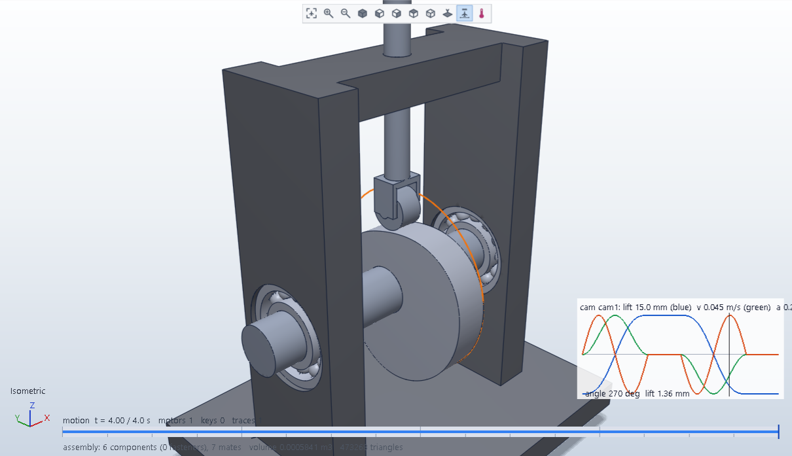

### Material colours

Every part is drawn in its material's colour: aluminium silver, carbon steel blue-grey, bearing and stainless steel
lighter, cast iron charcoal, brass gold, bronze and copper, titanium, Inconel, carbon fibre near black, glass/epoxy
green, ABS ivory, nylon cream, PTFE white, rubber black, oak brown, glass pale blue. Metals are glossy, plastics and
rubber matte, composites, wood and glass satin. The colour follows the component's material (right-click >
Material), else the part's, else its kind (fasteners, gears and sprockets steel); parts without one keep the palette
colours. The tree's swatches show the same colours.

## Flow round and through mechanisms

*Simulate > Parts in flow > Flow simulation* runs a fluid simulation on the assembly itself, in the Environment's
fluid: a lattice-Boltzmann solver (D3Q19) with the Smagorinsky large-eddy model, on a grid cut from the parts' exact
shapes. The turning parts turn in the flow at their motion-study speeds (their cells are re-cut as they turn).

* **Current past the parts**: the parts submerged in a current (inflow upstream, outflow downstream, slip walls at
  the sides, absorbing layers that stop the lattice fluid's sound waves ringing): wakes, vortex shedding, drag and
  lift, the drag coefficient and the Strouhal number. *Slip walls at the parts' ends* gives a 2D-like flow (an endless
  cylinder, a wing section).
* **Stirred vessel**: closed walls and a flat free surface; the turning parts stir the fluid from rest: torque, power
  and the stirrer's power number Np = P / (rho N^3 D^5), and how the turbulence grew.
* **In the view**: a slice of vorticity (vortices turning one way red, the other blue; or speed, or turbulence),
  vortex cores (surfaces where rotation beats strain, Q criterion), particles carried by the flow with short trails,
  the turning parts moving, and the kinetic and turbulent energy over time. *Flow view* cycles the slice. Record
  (Simulate > Flow display) films it.
* **The report** (results/studio/flow_*): the fluid, Reynolds number and regime, the grid and how much the turbulence
  model carries, the forces and torques (mean over the second half), the drag coefficient, lift and shedding, the
  power number, when the fluctuations passed 1 % of the kinetic energy, and the history as CSV.

**The whole fluid.** The parts sit wholly in the fluid, and the fluid itself is drawn: a stack of translucent coloured
slices across the line of sight, blue through green to red over the field's range (a colour bar gives the values and
units), the strong regions more opaque so the flow's structure shows through the volume. *Flow field* cycles what is
shown: **speed**, **pressure** (gauge, from the lattice density), **temperature**, **turbulence** (the fluctuating
velocity sqrt(2k)) and **vorticity**; *Fluid view* switches between the whole volume, a slice and both.

**Temperature.** With *Heat* on, the turning parts (or every part) are held at a hot temperature and the fluid starts at
the Environment's: the temperature is carried by the computed flow and conducted with the fluid's diffusivity, and the
warm fluid rises (Boussinesq buoyancy, *natural convection*). The report gives each hot part's heat into the fluid,
its heat-transfer coefficient h on the wetted area and the Nusselt number. The transport is first-order upwind (it
smears sharp temperature fronts where the flow is fast) and kept inside the hottest and coldest temperatures.

**Gears, belts and chains in fluid.** Turning parts move the fluid through their walls; belts and chains are moving bands
along their loop at the wheels' surface speed. *Gears in oil*: the 20:40 gear pair at 300 rpm, hot (80 C), wholly in
40 C SAE 30 oil (Re 42): the pinion and gear lose 0.21 and 0.23 W churning the oil and give 6 and 39 W of heat to it
(h 35 and 68 W/m2K); a warm plume rises from the mesh. *Belt in water*: the V-belt and roller-chain example running in
20 C water, every wheel's churning torque and heat. Gaps narrower than a cell between moving walls are reset to the
local equilibrium and counted in the report; forces on fixed parts in a closed vessel are not checked (the gear
example's plate shows an upward force larger than its buoyancy can explain).

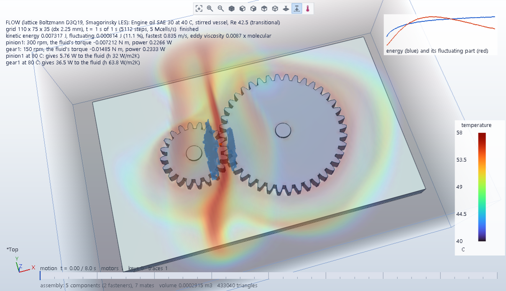

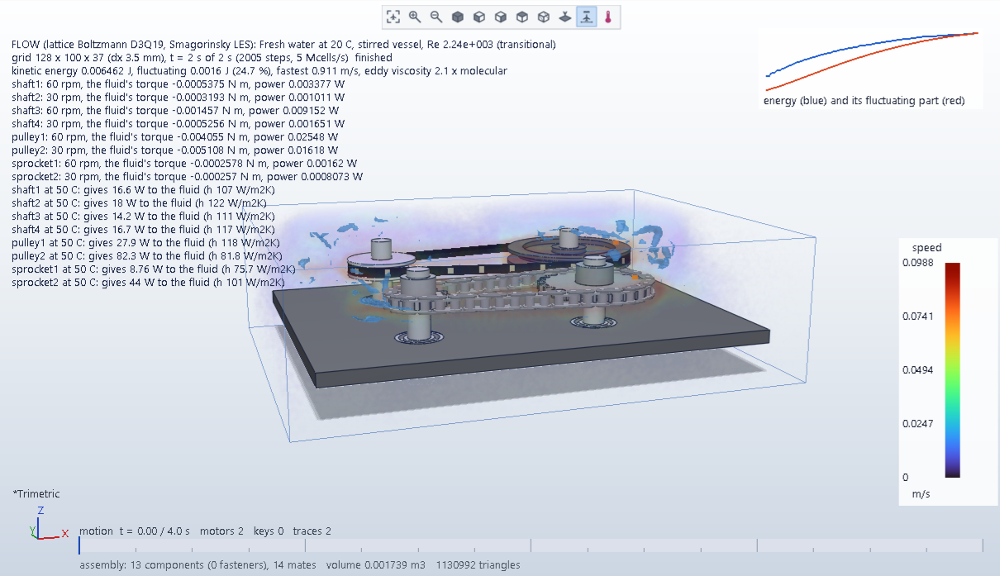

**The whole volume, in 3D.** The solver works on every cell of the x-y-z grid at once (the gear train in air: 219,000
cells, every one updated each step); the flow, the pressure, the turbulence and the heat move through the whole volume in
all three directions. Slices are only one way to look at it. The report adds *the whole volume*: the fluid's volume, its
mean and highest speed (with where), the mean turbulent energy, the pressure range, the mean, lowest and highest
temperature (with where the hottest fluid is) and the share of the volume above the mid temperature, and a bath's liquid
volume. (Single peaks can sit in an unresolved corner: the gear train's highest speed, 1 m/s, is such a spike beside
0.035 m/s tooth tips.)

**In 3D, from the Environment, for any design.** *Environment* now runs the 3D simulation of the whole volume by default (answer no
for the correlations only); it sets the
flow up from it: a liquid surface across the parts gives a bath, a current gives parts in a current, otherwise a
closed box of the fluid (air, water, oil...); parts warmer than the fluid are hot (the turning ones, or every part when
nothing turns: natural convection on its own works too). Any design can be simulated: a part design becomes the first
part of an assembly (the Environment is kept, Undo brings the design back). *Fluid view* shows the whole fluid as a
volume, a slice, **x, y and z slices** together, or a **cutaway box** (the field painted on the walls you look into and
the fluid inside translucent); the walls and the volume's slices follow the eye as the view turns. *Surface field*
adds the **heat-transfer coefficient** (the film coefficient of hot parts, W/m2K). Example: the gear train in air at
15 C with the gears at 60 C gives h 2 to 9 W/m2K, the tips highest (natural convection in air is 5 to 10 W/m2K in the
handbooks); a hole block at 60 C in still air, the plain part design set up the same way.

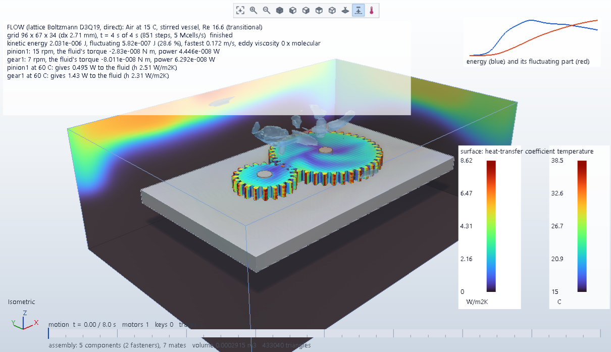

**Fields on the box walls.** The cutaway box's walls can show the field shown, **pressure**, **velocity** (the speed,
with arrows of the flow along the wall) or, the default, all of them at once: pressure on the x walls, velocity on the
y walls and the main field (temperature, turbulence...) on the floor and top. Each wall is painted from a layer a few
cells in from it (the layer touching a wall is held still by the no-slip condition) and each field has its own colour
bar from the walls' own values. *Wall fields* cycles the choice.

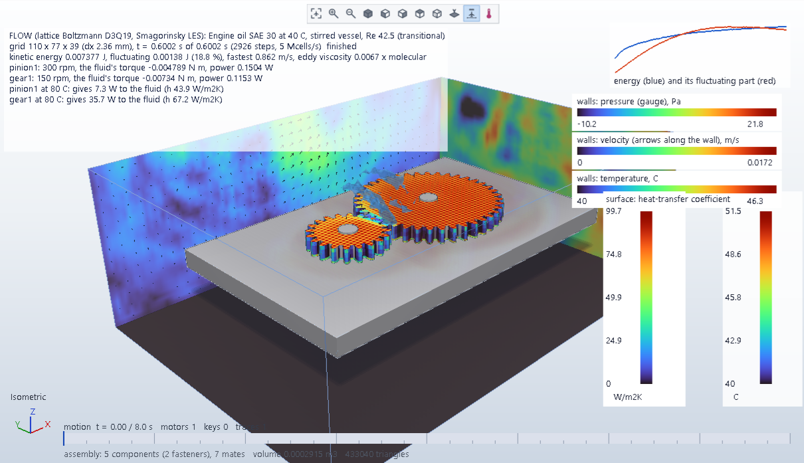

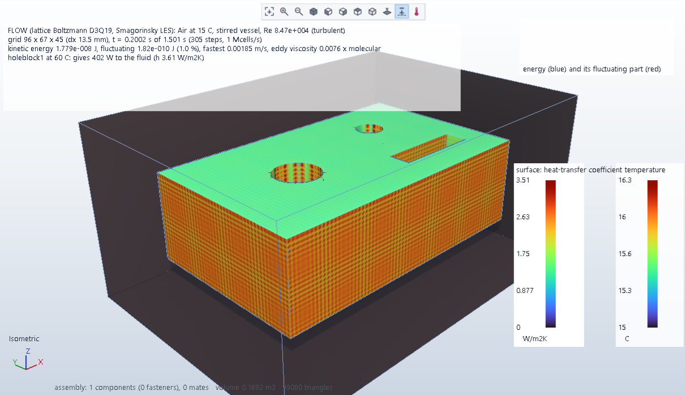

**A partly filled bath: the free surface.** The third set-up fills the box to the Environment's liquid surface and
leaves gas above it: the free-surface lattice-Boltzmann method (Koerner et al. 2005, Thuerey 2007), as used for
gearbox splash lubrication. Interface cells carry the liquid's mass and their fill; mass crosses between cells with the
streaming; cells fill and become liquid, or empty and become gas; what comes from the gas side is rebuilt at the gas's
constant pressure; gravity pulls the liquid down. The *liquid fraction* field (0 gas, 1 liquid) is the picture of the
splash: on the slice the gas is pale and the liquid red, through the volume only the liquid shows.

**Loss torque round a gear.** For every turning gear the torque of each wall link is gathered by its angle round the
gear and by zone: the **tip circle** (the tooth tips' cylinder) and the **flanks** (the tooth flanks and roots). Summed
over a tooth's pitch and averaged over the second half of the run, that is the no-load loss torque on one tooth as it
passes each angle, drawn as a polar plot round the gear (blue the flanks, red the tip circle, grey reference circles
labelled in N m) for the largest turning gear. The report gives both zones' share of the gear's churning loss and the
angle where a tooth loses most.

**The parts' surfaces.** *Surface field* colours the parts by the flow next to them: **friction** (the wall shear
stress mu |u - u_wall| / distance), pressure, temperature, turbulence or the liquid fraction (where the oil wets
them), with its own colour bar.

**Against the Environment analysis.** The report sets the simulation beside the Environment analysis' correlations for
the same parts in the same fluid: churning loss against a disc (von Karman) times the submerged share, heat-transfer
coefficient against the sphere correlations, drag against the sphere drag law.

**Gear splash** example: a 36-tooth spur gear (module 3, 20 mm wide) on a horizontal axis, dipping a quarter of its
diameter into gear oil ISO VG 220 at 40 C with air above, at 600 rpm, in a closed box. In 0.2 s (two turns) the oil is thrown up the box's wall and carried round on the teeth, and the gear loses **1.58 W**
(0.025 N m) churning it: the flanks 56 %, the tip circle 44 %; a tooth loses most just past the bottom of its path
(-101 deg), deep in the oil. The correlations for the same gear: 1.49 W as a disc (von Karman) times the submerged share,
**3.49 W** by Changenet and Velex (2007, Re 309, Fr 21.7, h/D 0.25): the simulation gives 45 % of the dip-lubrication
correlation, with about two cells per module on the teeth. The oil's mass ended at 97.5 % of the start (the free-surface
mass tracking loses a little where the teeth tear the surface). Two faults showed up on the way and are fixed: interface
cells pushed on the parts as if full of liquid (the gear seemed driven by the oil), and a meshing gear pair in a bath
passes torque from one gear to the other through liquid in a gap narrower than a cell, so a pair's losses there are not
reliable (the report says so).

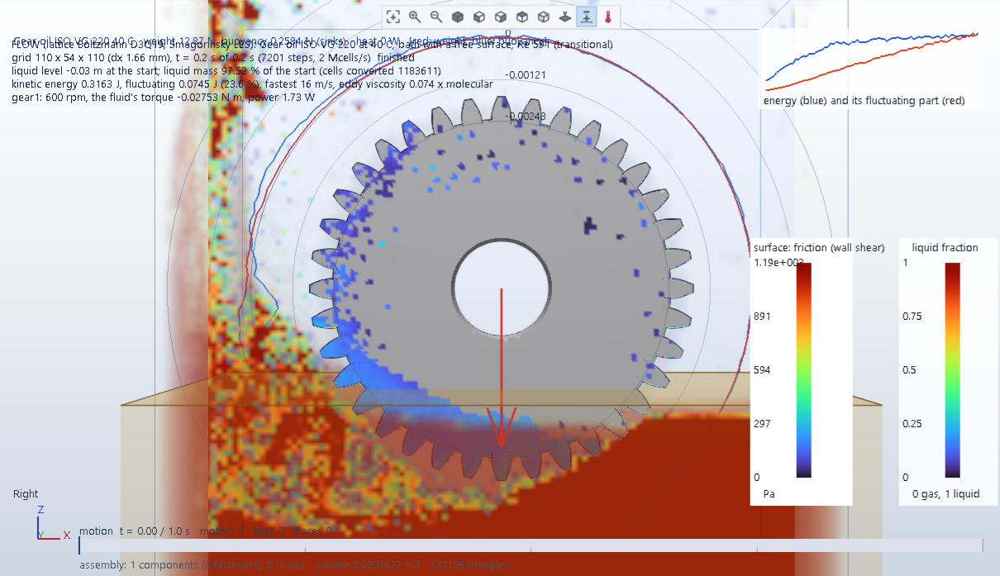

**Checks.** *Vortex street* (a 10 mm cylinder across water at 10 mm/s, Re 100, a 2D slice between slip walls, 14.7 cells across
the cylinder, 7.9 % blockage): the wake breaks into the Karman street after about 15 s and settles by 30 s; Strouhal
number **0.163** (measured 0.164, Williamson 1989), drag coefficient 1.54 (1.33 for an unconfined cylinder, about 1.45
with this blockage: 6 % high on the staircased surface), lift amplitude 0.27 (0.33). Getting there found three faults
in the first version, all fixed: lattice sound waves ringing between the side walls looked like shedding (absorbing
layers and a gentle start cure it), the slip walls took the mirrored populations from the wrong cell (it acted as
friction: St 0.143 until fixed), and a span wider than the part let fluid round its end.

*Mixing tank* (a Rushton turbine, D = T/3 = 67 mm, at 120 rpm in a baffled 200 mm tank of water, Re 8,900, 30 cells
across the turbine, 3 s from rest): the trailing vortices behind the blades show at once, the fluctuating energy passes
1 % of the kinetic energy within the first turn and levels off by 1.2 s at about 29 % of it. Power number **2.9**
against about 5 measured for this turbine in turbulent flow: the 3 mm blades are only 1.4 cells thick and their wakes
are under-resolved, so the torque is low. Treat stirred-vessel torque as a rough estimate unless the blades span
several cells.

Limits: the grid resolves the large eddies (10 to 30 cells across a body); walls are staircased with no wall
functions, so thin boundary layers at high Reynolds numbers are under-resolved and forces carry tens of per cent; the
free surface stays flat; parts that slide (racks, followers) stand still in the flow; the fluid is isothermal (heat
comes from the Environment's correlations). About 7 to 25 million cell updates a second on a laptop: a run takes
minutes.

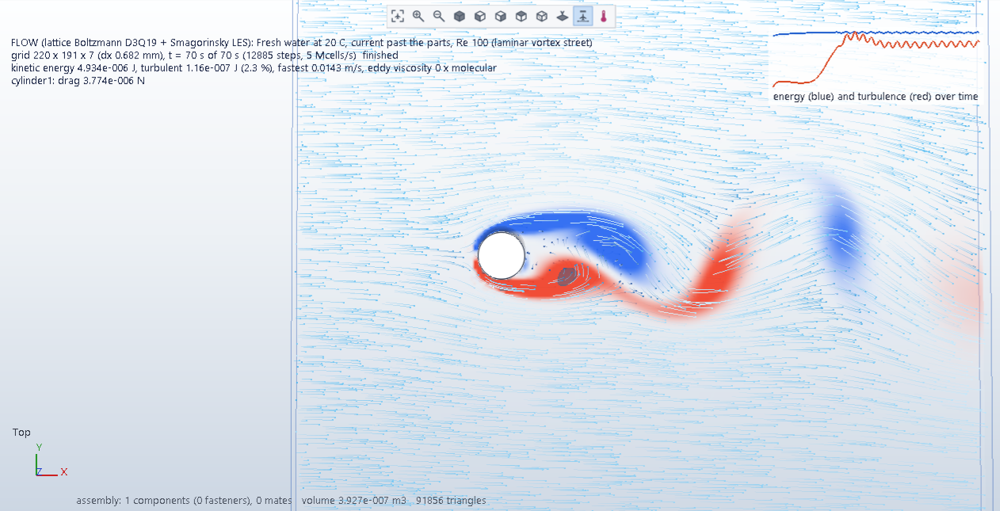

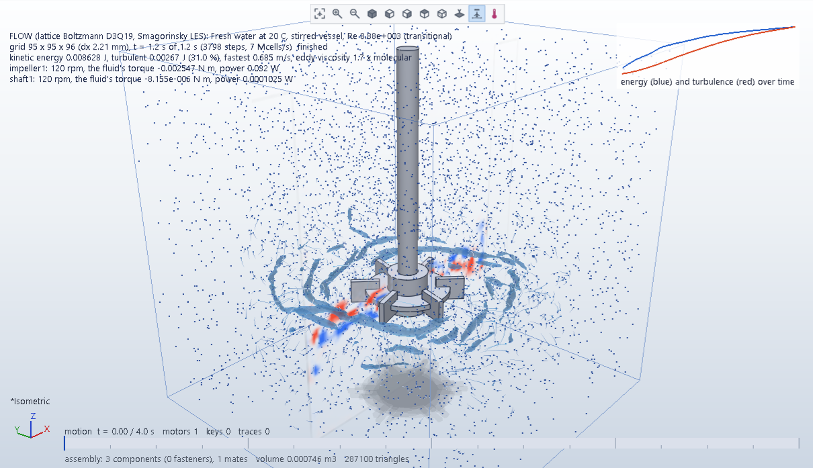

## Environment: how the parts behave where they work

*Environment* (Assembly & DMU tab, and Simulate > Physics) asks where the design works: the medium (air at an
altitude, fresh water, sea water, engine oil SAE 30 or vacuum), its temperature, a current (speed and direction), the
liquid's surface (or *find where it floats*), the parts' temperature or the heat they generate, the lubrication of the
mates and gravity (Earth, Moon, Mars or any value). For an assembly every part is analysed with its material
(right-click a part > Material: 24 engineering materials with density, conductivity, heat capacity, expansion,
emissivity, service temperature and galvanic index); a single design is one body. Studio then reports, per part and in
total:

* **Weight and buoyancy**, exact on the mesh (the submerged volume and its centre from the triangles cut at the
  surface), whether it sinks, rises or floats, and the **floating waterline** and draft; the **pressure** at the bottom.
* **Drag** in a current (sphere drag law of Clift and Gauvin on the projected area).
* **Heat transfer**: the convection coefficient (Whitaker forced and Churchill natural correlations on the equivalent
  diameter 6V/A; a partly submerged part has its wet and dry areas in their own media), radiation in gases and vacuum,
  the heat flow, the cooling time (3 tau of the lumped model, with the Biot number to say when that is optimistic),
  and the steady temperature under a heat load.
* **Thermal expansion** of every part and the **fits** of shafts in holes at temperature (a clearance that closes is
  flagged: the parts would bind).
* **Friction** of every contact mate from the material pair, the lubrication and the medium (oil lubricates, water
  partly; aluminium on aluminium galls when dry).
* **Coefficient tables**: for every part the Reynolds, Rayleigh and Nusselt numbers, the convection and radiation
  coefficients, the conductance to the surroundings, the solid's conductivity and diffusivity, the Biot number and the
  time constant; for every mate its contact (sliding, ball bearing, bushing, gear or worm mesh, friction drive, belt,
  chain, cam roller or face, bonded), the static and kinetic friction (handbook pairs from Marks and the CRC handbook,
  dry and lubricated, estimates marked), the rolling resistance and the thermal contact conductance (Incropera's
  aluminium values scaled by the pair's conductivity).
* **Motors**: the steady torque and power to turn the mechanism (bearing friction under the parts' apparent weight,
  fluid drag on turning parts as discs, gear mesh losses) and the extra torque to reach speed.
* **Warnings**: steel that rusts in water, aluminium that pits in sea water, galvanic couples between mated metals
  (MIL-STD-889 limits), parts above their service temperature, a liquid that freezes or boils, cold welding in vacuum.

The report opens in the results window (`results/studio/env_<date>/summary.txt` and `environment.json`); the 3D view
shows the liquid up to its surface, each part's weight (red) and buoyancy (blue) and the current. *Hide env* hides
them. The settings are saved with the document (`"environment"`).

Checked by hand: an oak block 1 x 0.5 x 0.2 m in fresh water at 15 C floats with a draft of 140.1 mm (hand:
0.2 x 700 / 999.1 = 140.13 mm); a 0.1 m steel cube in sea water weighs 77.01 N against 10.06 N of buoyancy (hand:
77.01 and 10.06), 1.22 bar at 2.05 m; a 100 mm aluminium ball at 60 C in still air at 15 C loses 9.30 W (hand, same
correlations: 9.30 W). These are engineering estimates: plates and long rods can differ by a factor of two in heat
transfer and drag from the compact-body correlations; use the CFD and thermal tools for design numbers.

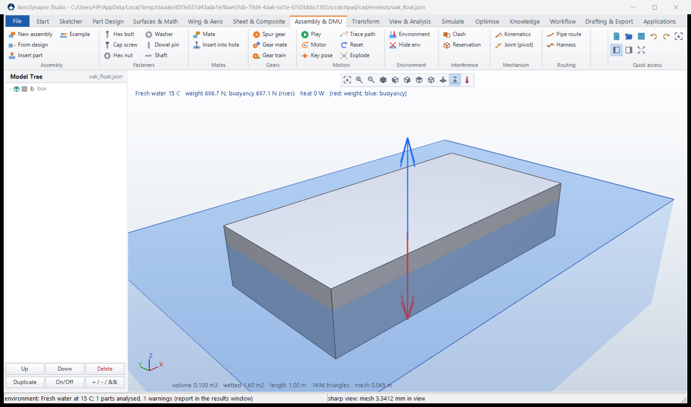

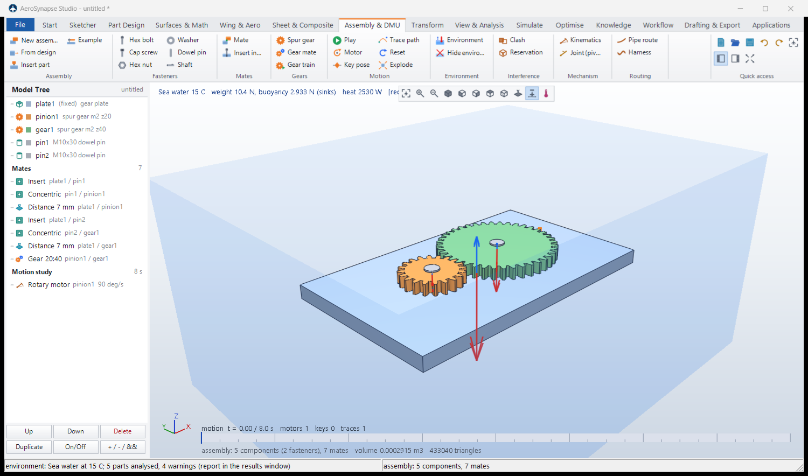

## Drawing from scratch: the sketcher

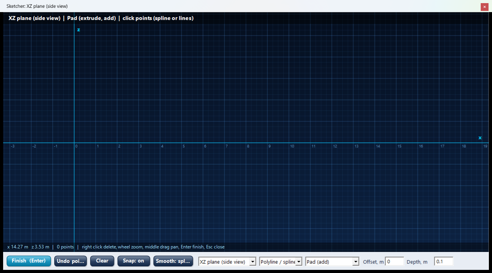

Pick **Plane XY** (top view), **Plane XZ** (side view) or **Plane YZ** (front view), and set its **offset**. Choose
the shape (polyline / spline, rectangle, circle, slot) and the operation (**Pad** adds, **Pocket** cuts, **Shaft**
revolves, **Groove** revolves a cut, **Loft**), and the **depth**. Left click adds a point (two clicks for a
rectangle, circle or slot), drag moves one, right click deletes one, the wheel zooms, middle drag pans. Each segment
shows its length and angle while you draw; hold **Shift** to keep it horizontal or vertical. **Snap** holds points to
a grid; **Spline** / **Lines** chooses a smooth curve or straight segments. **Finish** (Enter) adds the feature,
placed on the plane you chose.


### More sketch shapes and editing

Shapes (the shape list): polyline or spline, rectangle, circle, slot, **ellipse** (drag its box), **regular polygon**,
**rounded rectangle**, **star**, **involute gear** (drag from the centre to the tips; Sides = teeth, module 2R/(z+2)),
**arc slot** (drag from the centre: radius and sweep) and **triangle** (drag its base). *Sides* sets the polygon's
sides, the star's points and the gear's teeth. **Edit...**: mirror about the vertical axis (a half profile becomes a
symmetric one) or the horizontal axis, offset outwards or inwards, fillet every corner, rotate or scale about the
centre, **exact size** (type the width and height, radius, sides...) and **type points** (x y pairs).

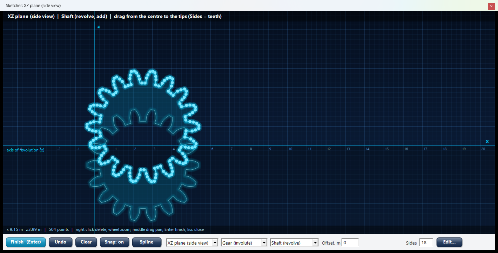

Also: **NACA airfoil** (drag the chord from the leading edge; type the 4-digit code in Sides, e.g. 2412), **L, T and I
sections** (drag the box), **keyhole** and **cross**. *Edit > Pattern on finish* makes linear (N copies DX DY apart) or
circular (N about the sketch's origin) copies of a pad or pocket.

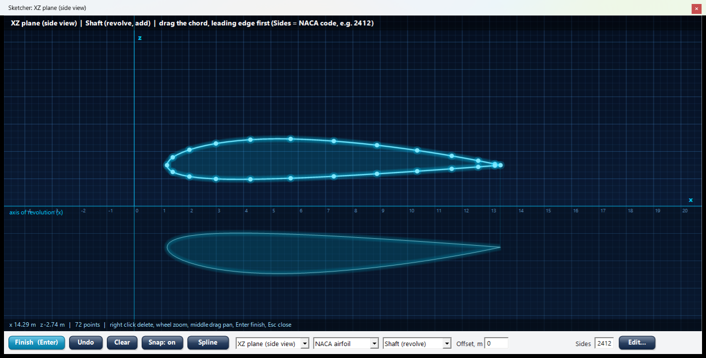

More shapes: **channel (C)**, **Z section** and **hat section** (drag the box), and **sheet metal (bend line)**: click
the sheet's mid-surface line, press Finish and type the thickness, inner bend radius and width; the result is a real
bent plate (the kernel's `bentplate`, with true bend radii), not an extrusion. *Edit* also has **chamfer the corners**,
**reverse the point order**, **import an outline from DXF** (the largest closed polyline or circle of an AutoCAD file,
millimetres to metres), **export the sketch as DXF** and **send the sketch to the 2D drawing**.

## 2D drawing (AutoCAD-style drafting)

*Sketcher > AutoCAD 2D* or *Drafting & Export > 2D drawing* opens a drafting window in the manner of AutoCAD: a dark
model space in millimetres with a grid, the full-screen crosshair, layers (OUTLINE, HIDDEN dashed, CENTER dash-dot,
DIM, TEXT, BORDER), and a **command line** that takes AutoCAD's aliases and coordinate input:

| Command | Alias | What it does |
|---|---|---|
| LINE, PLINE, RECTANG | L, PL, REC | lines, polylines (C closes), rectangles |
| CIRCLE, ARC | C, A | circle by centre and radius (a point or a number), arc through three points |
| DIMLINEAR, DIMRADIUS | DLI, DRA | horizontal/vertical dimensions, radius dimensions |
| TEXT | T | text at a point |
| ERASE, MOVE, COPY, MIRROR, OFFSET | E, M, CO, MI, O | editing the picked entities (click picks, Shift adds, Delete erases) |
| ZOOM, UNDO, REDO | Z, U | zoom to the extents, undo, redo |
| VIEWS | | the design (part or assembly) in front, top and left views and an isometric on an A3 sheet, first-angle, with a title block, overall dimensions and centre lines; hidden edges dashed on the HIDDEN layer |
| FLAT | | the flat pattern of the selected bent plate: the blank with its bend zones, bend lines and UP/DOWN notes (K = 0.44, the same rule as Unfold) |
| SKETCH | | the largest closed outline to the 3D sketcher (mm to m), ready to pad |
| DXFIN, DXFOUT, PNGOUT | | open and save AutoCAD R12 DXF (lines, circles, arcs, polylines, text; LWPOLYLINE and MTEXT are read too), save a picture |

Points: click, or type `x,y` (absolute), `@dx,dy` (relative), `@len<angle` (polar), or a single number (that length
along the cursor's direction). F3 object snap (end, middle, centre, quadrant, with AutoCAD's markers), F8 ortho, F9
grid snap; Enter or a right click ends a command or repeats the last one, Esc cancels, the wheel zooms, a middle drag
pans. The three views come from the model's triangles: feature edges (creases sharper than 35 degrees and the
silhouette) projected, a depth buffer deciding what is seen; hidden silhouettes are left out, as a drawing office does.

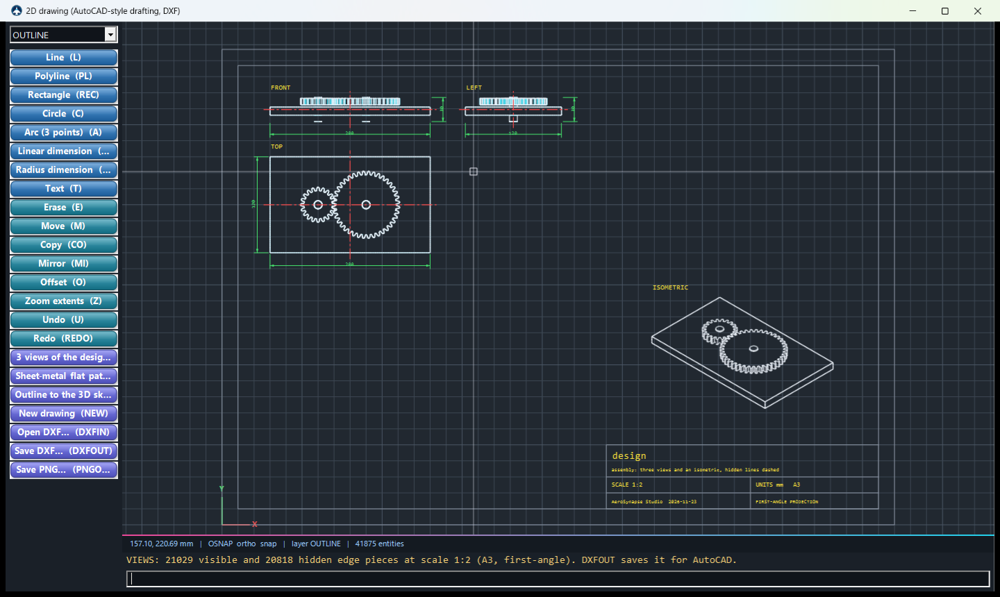

**Sheet metal.** *Sheet & Composite* now has *Sheet from sketch* (above), *Flat pattern* (the blank in the 2D
drawing, to save as DXF for the laser) and presets: **U channel**, **Z bracket**, **hat stiffener** and **L bracket**
(3 mm, R6 bends, 400 mm wide). The hat stiffener's blank is 386.0 x 400.0 mm, the same as Unfold gives.

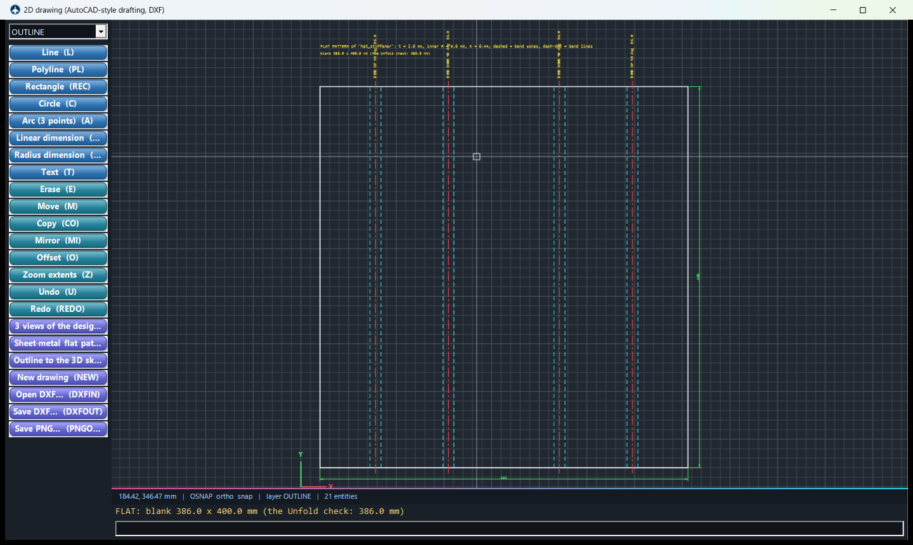

## Simulation

Every analysis opens a **setup form** first: you choose every condition and input, then press *Run with this setup*.
The form is built from the same schema the analyses use (`assets/sim_setup_schema.json`), so nothing is hidden:

| Analysis | What you choose |
|---|---|
| **3D flow** (CFD tiles, *Flow setup*) | preset; Mach, angle of attack, sideslip, altitude, hot/cold day; **free-stream turbulence intensity and length scale**; gust amplitude and wavelength; viscous or inviscid, wall model, LES model (WALE, Smagorinsky, none), low-Mach correction, thin-surface treatment; quality or your own cells per length and steps, full or half model, time-accurate or steady, averaging window, CFL, residual target, cell limit, grid stretching, domain size; saving the 3D field; up to three probe points |
| **Turbulence and instability** | the 3D flow run to analyse; flight condition; free-stream Tu, critical N override, wing station, surface finish; wake stations, collocation points, wavenumber range; spectrum segments |
| **Analytic** | panel-method angle range and step, lifting-line angle, nose and section-theory Mach numbers, dash Mach, altitude, duration and starting skin temperature |
| **PINN** | the three check Biot numbers, the field Biot number, and the material and thickness of each of the eight skin zones |
| **Structure** | take-off mass, wing fuel, design code, dive speed, maximum lift coefficient, wing-box material, structure temperature |
| **Composite laminate** / **Clash** | ply layup and ply material / analysis spacing |

Clicking a field shows its meaning, unit and allowed range; values outside the range are refused before the run.
The form remembers your values; *Defaults* restores them, *Save* and *Load* keep setups as files.

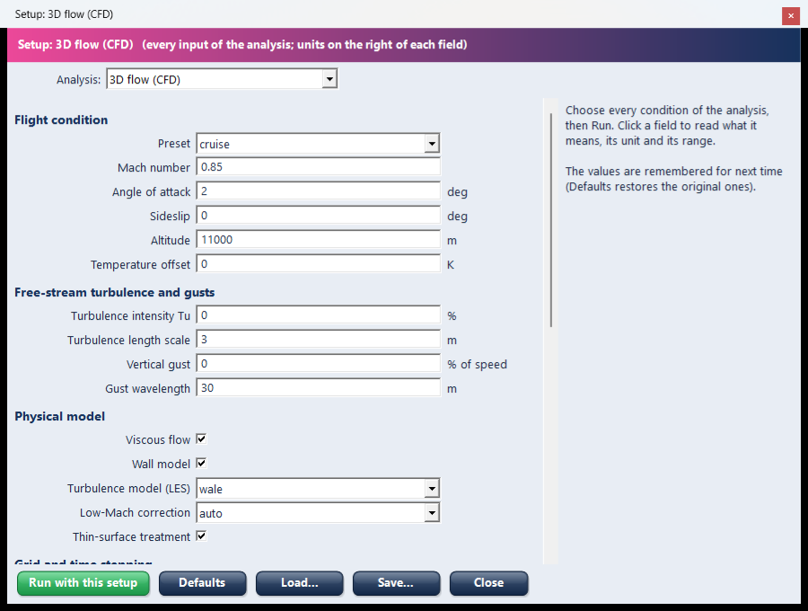

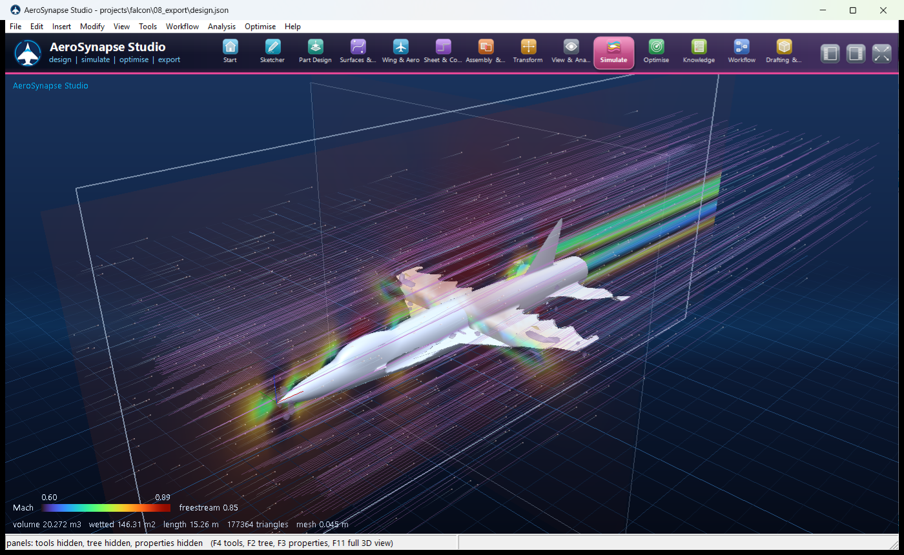

### Full-3D flow

The CFD tiles run the compressible flow solver on the **whole aircraft** (both sides, no symmetry plane) and save the
**complete 3D flow field**. The results then show in the 3D view:

| Display | What it shows |
|---|---|
| **Streamlines** | about 400 streamlines from a rake upstream of the aircraft and rings around the wing tips, coloured by Mach number (pulses running downstream in the Vivid display) |
| **Vortex cores** | the Q-criterion surface (pink): tip and strake vortices |
| **Sonic surface** | the M = 1 surface (amber) where the flow goes supersonic |
| **Flow field** | Mach-number slices through the volume; undisturbed flow stays clear; **Slice axis** cycles x, y, z, and Ctrl+wheel moves the slice |
| **Particles** | 650 tracers carried by the 3D velocity field, tinted by Mach number |
| **Surface** | pressure, friction or temperature painted on the model |

| Case | Flight condition |
|---|---|
| Cruise | Mach 0.85, 2° incidence, 11 km |
| Transonic | Mach 0.95, 6°, 5 km |
| Supersonic | Mach 1.6, 2°, 12 km |
| High alpha | Mach 0.3, 25°, 6 km |
| Sideslip | Mach 0.6, 4° incidence, 5° sideslip, 6 km |
| Gust | Mach 0.7, 3°, 3 km, a vertical gust of 5 % of the flight speed over a 20 m wavelength, time-accurate |

**Quality** sets the grid and the number of steps: *live* (18 cells per body length, 260 steps), *draft* (30, 900), *standard* (48, 2,500), *fine* (70, 3,500).
The live grid is for watching the flow pattern only: about 50 cells touch the aircraft and the forces are not reliable,
which the summary says in a warning. A standard
run of the Falcon (331,000 cells, full model) takes about 45 minutes on a laptop. **Live simulation** re-runs a
live-quality case two and a half seconds after each edit.

The same analysis from a terminal, with its report figures (convergence, surface pressure, wing sections, field
slices and two 3D renders):

```bash
python -m aerosynapse.cli simulate cfd design.json --case cruise --quality standard --out results/cfd3d/cruise
python -m aerosynapse.cli simulate flow3d results/cfd3d/cruise    # re-draw the figures of a finished run
```

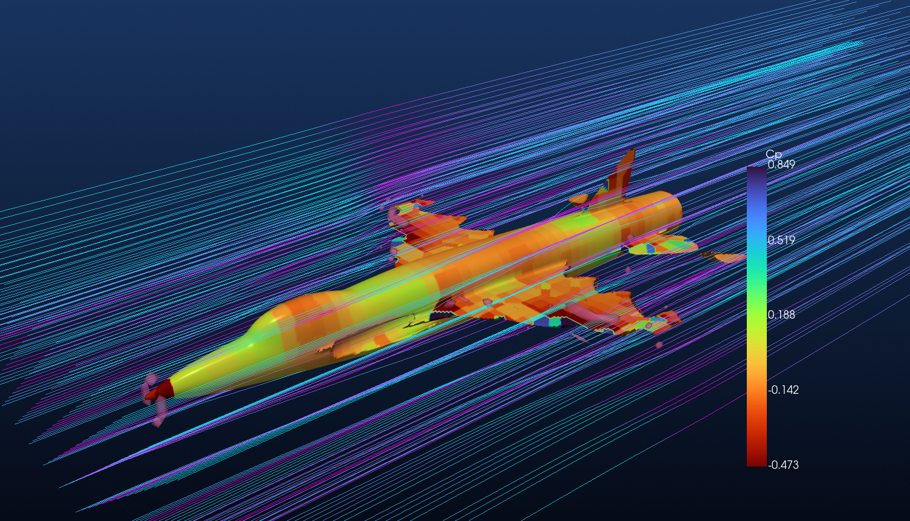

#### Flow pictures: temperature and tracers over vorticity

Every 3D run that saves its field also draws two plane cuts in the thermal project's paper style: a wing section
(at 55 % of the semi-span, set by **Wing section for the pictures**) and the centre plane. Each is two panels:

* **top, temperature and tracers** - the temperature rise (T - T∞)/(T₀ - T∞) on the inferno scale, black in the
  undisturbed stream and bright where the air is compressed and heated (stagnation points, shocks, the wake), with
  white tracer particles carried by the in-plane velocity;
* **bottom, vorticity** - the vorticity normal to the plane, ω L / U, on a diverging red-blue scale centred on zero.

The solid is the design's exact section (from the kernel), not the solver's staircase. With **Flow pictures** set to
*stills and movies* (the default) each cut is also an MP4 (8 s) of the tracers streaming through the flow; the
results window lists the movies after the figures and plays one when it is picked. Both cuts with their movies take
about 35 s. The pictures show what the grid resolves: on draft and live grids the wake is several cells thick and
looks wider and hotter than it is.

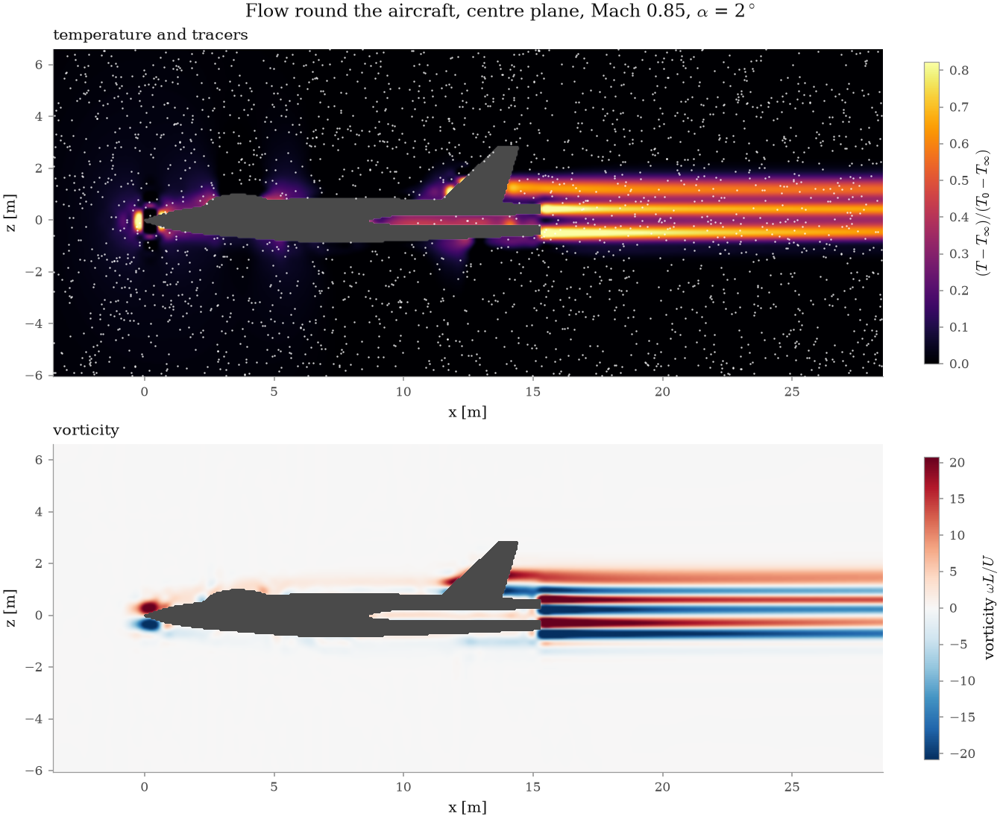
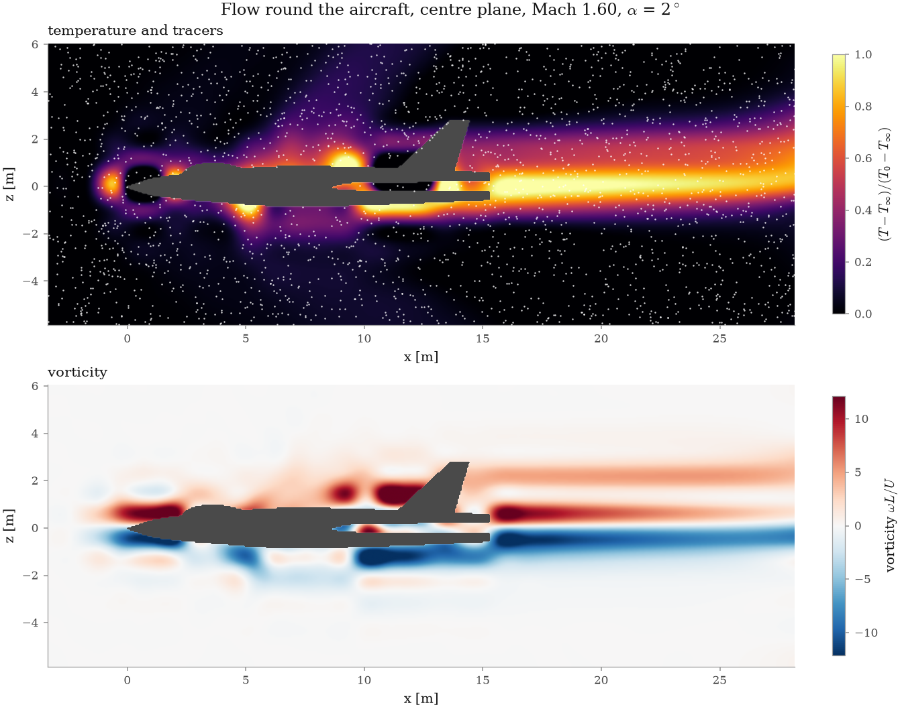

```bash
python -c "from aerosynapse.sim import flowviz; print(flowviz.run('results/cfd3d/cruise'))"   # redraw for a finished run
```

#### Faster runs: stopping on settled forces

The forces of a steady run swing slowly round their final value long after the flow pattern has formed. Two
settings in **Grid and time stepping** use that:

* **Stop when forces settle** (0.5 % by default) - the run stops once the mean C_L and C_D over the last 600 steps
  agree within this band with the mean over the 600 steps before, and reports that last mean. Steady runs get up
  to 2,400 (draft), 4,000 (standard) or 5,000 (fine) steps so they can settle; most stop well before.
* **Start from** - *free stream* (default); *coarse pass first* runs the flight on a grid 0.55 times as fine and
  starts the full grid from its field (grid sequencing); *previous run* starts from an earlier run of the same
  flight (**Previous run folder**).

Measured on the Falcon cruise, draft grid, full aircraft (`scripts/cfd_speed_benchmark.py`,
`results/cfd_speed/benchmark.png`):

| Run | Steps | Time | C_L | C_D |
|---|---|---|---|---|
| every step | 2,400 | 882 s | 0.04351 | 0.01072 |
| stop on settled forces | 1,420 | 477 s (**1.85x faster**) | 0.04348 (-0.07 %) | 0.01073 (+0.10 %) |
| coarse pass first, then stop on forces | 800 + 1,370 | 859 s (1.03x) | 0.04352 | 0.01073 |

Grid sequencing did not pay on this case: the interpolated start jolts the fine field and the slow force swings
set the run time either way. Before this change draft steady runs stopped at 900 steps, long before they settled
(C_D 0.030 against 0.0107); see KI-71.

### Smooth playback and the whole system's axes

The view blends the solver's last two snapshots over the time between them, 40 frames a second: the colours change
smoothly, the particles move every frame and the parts turn steadily instead of jumping from snapshot to snapshot (the
picture runs one snapshot behind the solver). Snapshots come at least every 10 steps. The parts' surface fields are
averaged over neighbouring vertices (three passes), which removes the cell-size checker pattern. The box carries the
whole system's **X (red), Y (green) and Z (blue) axes** along three edges from its low corner, with ticks labelled in
millimetres, and each run writes **profile_x.csv, profile_y.csv and profile_z.csv**: for every plane across x, y and z
the mean speed, the mean of each velocity component, the largest speed, the temperature and the liquid fraction. The
report gives each component's share of the kinetic energy and the fastest plane along each axis.

**Gaps and the grid.** The grid is chosen from the finest gap: a gear's tooth space is about 1.6 modules wide, so the
set-up asks for three cells across it (dx <= module / 2), other parts for ten cells across their smallest size, at most
200 cells along the longest side. A gap still one cell wide between two solids, at least one of them moving (meshing
teeth), is **bridged**: that cell becomes wall moving with its neighbour and is freed when the gap opens (the report
counts them). **Refine grid** (Parts in flow) runs the same flow again with 1.5 times the cells (up to 320) and the report
sets the two grids side by side (cell size, bridged cells, kinetic energy, each part's torque). On the gear pair in oil,
110 to 165 cells: the pinion's torque changes by 8.8 %, the wheel's by 0.2 %, the kinetic energy by 7.9 %. Cells beyond
the lattice's valid speed (above 0.35 dx/dt) are counted and left out of the profiles; since the fix below there are
none in that example.

*A bug that was found and fixed (2026-11-23).* The velocity snapshot started every cell at u = (1, 1, 1) in lattice
units, and a cell a gear tooth uncovered between two snapshots showed that value (a speed of 19.96 m/s in the gear
example, about fifteen times the tip speed). It looked like an unresolved gap; a dump of those cells showed all of them
with exactly that speed and a density of exactly 1. The snapshot now starts at rest and a freed cell gets its refill
velocity in both buffers. The forces and torques were never affected (they come from the solver's own populations), but
the views, the surface fields and the per-axis profiles were: the energy split along x, y and z read 34 / 34 / 31 %
before and 48 / 48 / 4 % after, as it should for gears turning about z.

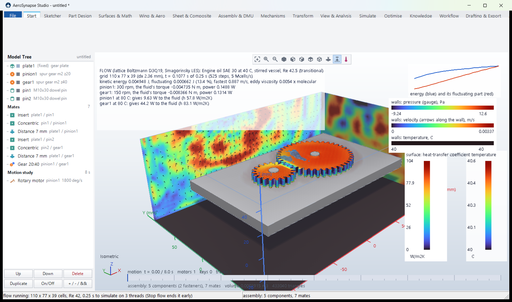

### Flow animations

With a 3D result open (*Flow field*), *Simulate > Flow display* adds:
* **3D lines**: streamlines traced through the solver's whole flow volume (a rake across the span upstream, and lines
  starting just off the front of the aircraft's surfaces), coloured by Mach, with bright pulses that travel along
  them at the local flow speed. A half-model run is mirrored, so both sides show.
* **Particles** are larger, with Mach-coloured heads and trails, and fill both sides of a half model.
* **Sweep**: the active Mach slice glides through the flow and back (*Slice axis* sets the direction).
* **Record**: records the 3D view (orbit, zoom or run any animation meanwhile) and, when clicked again, encodes it to
  `results/studio/anim_<date>/animation.mp4` at 30 fps (at most 60 s; `scripts/frames_to_mp4.py`).
* The Mach legend is drawn in dark text, so it reads on the light background.


### Design optimisation with CFD

**Optimise** (Simulation workbench, or *Analysis > Optimise the wing with CFD...*) searches for the best main wing with
the 3D flow solver itself. Each candidate wing is a full-aircraft CFD run stopped on settled forces, so
the budget is counted in runs. The search is Bayesian optimisation:

1. the baseline design, then a space-filling set of wings (Latin hypercube);
2. a Gaussian process (Matérn 5/2 kernel, one length scale per variable, a noise term for the solver's scatter) is
   fitted to the results;
3. the next wing is the one with the largest **expected improvement** over the best so far;
4. repeat until the budget is spent.

| Setting | Choices |
|---|---|
| Objective | largest L/D, least drag, most lift; optional lowest C_L allowed (a soft penalty) |
| Variables | leading-edge sweep, taper ratio, tip twist, dihedral, span (each on or off, with its own range); the wing area can be kept, so the root chord follows span and taper |
| Search | number of CFD runs (14 by default), space-filling runs, random seed, grid of each run (draft by default), force band |
| Flight | Mach number, angle of attack, altitude |

The results window shows the optimisation history, the objective against each variable with the surrogate through
the best wing, the surrogate map over the two most important variables, the two planforms, and the flow round the
baseline and the best wing as two-panel pictures. `best_design.json` in the results folder is the best wing; open it
and run a standard-quality CFD case to confirm, since each run of the search carries its grid's discretisation
error.

```bash
python -m aerosynapse.cli simulate optimise design.json --setup optimise.json --out results/optimise/wing
```

**Read the grid warning.** A study is only as good as the forces of its runs. Each run's wall-cell count is in
`history.csv`, and below about 120 cells touching the aircraft the summary starts with a warning: the ranking of
wings may then come from grid error. The first study of the Falcon (sweep and twist, 8 runs, 40 min) reported
+22.6 % L/D but used half models with 48 + 60 wall cells, and half and full models disagree on that grid (KI-68);
its summary is marked not reliable. The optimiser now always runs the full aircraft. Use a grid fine enough for
reliable forces, and confirm the best wing on the next finer grid before acting on it.

### Turbulence and flow instability


| Part | Method | Output |
|---|---|---|
| **Free-stream turbulence and transition** | panel-method velocity on the wing section, Thwaites laminar boundary layer, e^N envelope method (Drela and Giles 1987), critical N from Tu (Mack: N = -8.43 - 2.4 ln Tu), laminar separation | growth of Tollmien-Schlichting waves, shape factor, transition on both surfaces, transition position against Tu, friction drag with and without the laminar run |
| **Wake instability** | wake profiles from the 3D flow fitted with Gaussians (or momentum-matched model wakes), inviscid Rayleigh equation solved by Chebyshev collocation | growth rate against wavenumber for the sinuous (vortex-street) and varicose modes, frequency, Strouhal number, e-folding time. The solver is checked on the tanh mixing layer against Michalke (1964) every run |
| **Turbulence in the field** | time-accurate 3D flow with synthetic inflow turbulence (random Fourier modes seeded in the whole field and forced in a slab upstream of the aircraft); statistics over the second half of the run | turbulent kinetic energy, r.m.s. velocity and vorticity in 3D; velocity spectra at the probes with the Kolmogorov -5/3 line; measured inflow intensity and integral length |


On a draft grid the forced inflow turbulence reaches the aircraft at about a third of the requested intensity (1.8 % of 5 %): eddies smaller than about four cells decay. The summary prints the requested and measured values side by side.

Run a 3D flow with *Turbulence intensity* above zero (or the *turbulent* preset) and *Save the 3D field*, then
*Turbulence*: the form fills in that run.

```bash
python -m aerosynapse.cli simulate cfd design.json --setup flow.json --out results/turb_run
python -m aerosynapse.cli simulate turbulence design.json --setup turbulence.json --out results/turb_run/analysis
```

### The other simulations

| Kind | What it computes | 3D view |
|---|---|---|
| **Analytic** | panel method on the wing's own section, Prandtl lifting line, Sears-Haack area rule, Taylor-Maccoll cone and normal shock, Ackeret supersonic section theory, exact transient skin heating | lifting-line load ribbons and the Sears-Haack body |
| **PINN** | the parametric PINN against the exact series and finite differences, its error fields and speed, the design's skin zones | skin zones coloured by peak temperature |
| **Structure** | design-code envelope and loads, wing box gauges, finite-element deflection, V-g and V-f flutter, fuselage bending | the deflected wing (exaggerated) coloured by cover stress |

The results open in the **simulation results viewer**. It lists everything in the result folder: figures, every data
table (CSV) drawn as charts there (one panel per column, against the first column), interactive 3D pages (opened in the
browser), movies and the summary, so it always has something to show: the flow, environment, power-flow and
interference results also save a picture of the 3D view (`00_view_3d.png`). Thumbnails along the bottom pick a figure;
**Pop out** opens the entry in a window of its own (several at once; wheel zoom, drag pan, double-click fit, S saves).


### Labs: every lab inside Studio

THERMAL LAB, the PINN heat-transfer app, the Designer and the research workbench used to open as web pages in the
browser. They now run inside Studio, in the **Labs** window (*Simulate > Labs*, *PINN lab*, *PINN heat app*,
*Workbench*; *Optimise > Designer*; the optimisation centre and the application catalogue open it too):

| App | Pages |
|---|---|
| THERMAL LAB | overview; solve (solver, PINN, compared); grid convergence (8 schemes); PINN parameter sweep; inverse identification of alpha, k, h (synthetic or your CSV); real soil data: diffusivity from buried sensors (stations on disk or your table); lumped cooling fit; cavity flow (Navier-Stokes and heat in time, three heatings, four lids); dataset pipeline (design of experiments, ground truth, sensors, noise); real-data PINN training with progress; the lab's ZIP export on every page |
| PINNs for heat transfer | overview, solver, PINN, comparison, inverse, convergence, training monitor, uncertainty and validity, export |
| Designer | design workflow, optimisation centre, fighter editor and study, 3D flow, materials, skin heating (PINN), data store, aircraft design, mission, analysis, optimise, study results, shape library, data |
| Research workbench | physics, simulation, ML, optimisation, research |

All 39 pages are the apps' own code: a Python worker (`aerosynapse.nativelab`) answers each page's inputs and records
what it shows; Studio draws the inputs as native fields (with their ranges; a choice or a tick re-runs at once, buttons
are buttons, files are picked with a file dialog) and the output as a native report: headings, numbers as cards,
figures (Plotly charts redrawn with Matplotlib), tables, code, notes and downloads; a click on a figure or a table opens
it on its own. Nothing is served to a browser.

**Inputs from the design.** With *Inputs from the design* ticked, the labs start from the open design and assembly:
the selected part (or the largest), its material (density, conductivity, heat capacity), its size and turning speed,
and the Environment's fluid, temperatures and current. From them come the Biot number (h from a flat-plate correlation,
forced by the current or the part's surface speed, else natural convection), the Peclet, Reynolds, Prandtl and
Richardson numbers, the volumetric heat source, and for the aircraft designer the body length, wing area, aspect
ratio, taper and sweep of the fuselage and wing features. Each such input is marked "from the design" in green, and the
report opens with what was taken and how. Where a design value lies outside what a model was trained for (a steel
pinion in oil gives Bi 0.079, the PINN was trained on 0.3 to 3), the app's own guard says so instead of extrapolating;
untick the box to go back to the apps' defaults. A real-data training run shows its progress and the clock time it
finished.


### AirfRANS: flow surrogates trained on the Kaggle data

The folders `graph_airfrans_data_batch_1` to `_10` (the Kaggle download, about 35 GB) hold **AirfRANS** (NeurIPS 2022
Datasets and Benchmarks, ODbL-1.0): 1000 RANS simulations of 2D airfoils, one PyTorch Geometric file each, about
180 000 mesh nodes with the inlet velocity, the distance to the wall and the wall normal as inputs and u, v, p and the
turbulent viscosity as fields. The folders reuse file names but hold different simulations (no duplicates were found).
The files are pickles; they are read with PyTorch's weights-only loader and stand-in classes, so no code from them runs.
Every value was min-max scaled to [0, 1] by whoever prepared the files and the constants are not included, so all
results are in those scaled units (no lift or drag coefficients in physical units).

*Simulate > Labs > AirfRANS* (or `python -m aerosynapse.ml.airfrans_graph all --profile quick|full`): every wall node
and 6000 sampled field nodes of each simulation (7.0 million points, 104 MB) are kept; the simulations are split
800 / 100 / 100 (train, validation, held-out test, by simulation); two networks are trained on the CPU, then tested on the
100 held-out airfoils at the sampled points and at every node of 20 full meshes. Relative L2 error ||prediction -
RANS|| / ||RANS - its mean|| per field (20 epochs, 1.9 hours in all at low priority):

| Model, epochs | u | v | p | nu_t | p at the wall |
|---|---|---|---|---|---|
| MLP (point-wise, 110 000 parameters), 20 | 50.7 % | 43.0 % | 48.3 % | 54.3 % | 56.7 % |
| MLP, 50 | 49.2 % | 42.0 % | 43.9 % | 50.7 % | 50.1 % |
| PointNet (with a code of the whole airfoil, 147 000 parameters), 20 | 39.4 % | 34.6 % | 28.6 % | 38.5 % | 35.3 % |
| PointNet, 50 | **36.0 %** | **30.2 %** | **19.8 %** | **27.4 %** | **33.2 %** |

The 20-epoch run (`--profile quick`, 1.9 hours) is in results/airfrans_graph, the 50-epoch run (`full`, 3.4 hours on
the same extracted points and split) in results/airfrans_graph_full; the Labs pages use whichever is better (the
50-epoch one). Training longer helped the PointNet most (pressure 28.6 to 19.8 %, nu_t 38.5 to 27.4 %); the MLP barely
moved, so its limit is what it can see, not the training time.

The point-wise MLP only knows each point's distance to the wall and its normal, not the shape it belongs to; the
PointNet adds a code of the whole simulation and roughly halves the pressure error. Both are far from the AirfRANS
paper's graph networks: the networks are small enough for a laptop CPU, the Fourier position features leave faint stripes in the fields, and the
leading-edge pressure is often wrong (the wall-pressure figure). At the wall only pressure is scored: u, v and nu_t are
constant there (no slip), so a relative error has nothing to divide by. The Labs pages show the dataset, these results,
a prediction for any held-out airfoil at every mesh node, and train again.


### Ultra-clear images

*View & Analysis > Ultra-clear image* (also under *Drafting & Export*) draws the 3D view again off screen (an OpenGL
framebuffer) at 2x or 3x the view, 4K, 6K or 8K, with 2 x 2 supersampling (four samples a pixel, averaged): edges, lines
and text come out sharp, not an enlarged screen grab, and text and line widths grow with the picture so the layout
matches the screen. It saves PNG, JPEG (quality 95), TIFF, BMP or PDF (the picture on its own page at 300 dpi), with the
AeroSynapse logo and the design's name in a corner if you like, under a clean name:
`AeroSynapse_<design>_<view>_<width>x<height>_<date-time>.<format>` (in results/studio/images unless you choose another
folder). The pictures every analysis saves in its result folder (flow, environment, power flow, interference) are drawn
the same way at twice the view with the logo. `--hq-image FILE` saves a 4K picture from the command line. The 2D
drawing saves its picture at three times the window (any of those formats) and as true vector **SVG** and **PDF**
(SVGOUT, PDFOUT: lines, arcs and text on white paper, layer colours and line types kept).


### Fin PINN: every optimisation setting, 2D and 3D

*Simulate > Thermal and PINN > Fin PINN* (also in the optimisation centre, and `python -m aerosynapse.thermal.fin_pinn
--out DIR --profile quick|full`). The cooling fin of the optimisation demos, `-theta'' + m^2 theta = q(x; x_s)` with a
heat sink at x = 0 and a convective tip:

1. **Extracted data.** Nine optimisation settings (gradient descent, Adam, L-BFGS, SQP, differential evolution, genetic
   algorithm, Bayesian optimisation, constrained BO, trust-region surrogate) run on the fin with the finite-difference
   model; every design they evaluate is kept with its temperature profile: 1068 designs x 101 points. A 7 x 7 grid of
   other designs is held out.
2. **Parametric PINN** theta(x; m, x_s) trained on that data and on the fin equation and tip condition (the sink holds
   exactly), and a data-only network of the same size beside it.
3. **Analysis**, each optimisation setting with its own colour, marker and line style in every figure: the extracted
   data over the objective map, convergence, theta(x) at each optimum (FD and PINN), training losses, held-out error
   maps, the equation residual, the energy balance (sink + lateral convection + tip = source), every optimiser re-run
   with the PINN in the loop and checked by FD, and in 3D: theta(x, m), the optimisers' paths over the objective
   surface, the optimum fins coloured by temperature and the PINN-minus-FD objective surface; plus an interactive 3D
   page. It opens in the results viewer; Pop out puts any figure in its own window.
4. **Every optimisation setting on its own**: a 2D analysis (its path over the objective map with the order of its
   evaluations, its convergence, theta(x) by FD and PINN at its optimum with the difference, its energy balance and its
   PINN-in-the-loop check) and a 3D one (its path over the PINN objective surface, its optimum fin coloured by
   temperature). The results viewer shows a **button for each setting** (and Everything, Overview): one click shows only
   that setting's figures.

Figures are named `FinPINN_<SETTING>_<figure>_<2D|3D>.png` (SETTING: ALL, GD, ADAM, LBFGS, SQP, DE, GA, BO, CBO, TR),
carry the AeroSynapse logo and a footer (study, setting, 2D/3D, date), are saved at 300 dpi, and have PDF copies (and SVG
for the 2D ones) in `vector/`. `settings.json` lists the settings with their colours and markers; the training history
and both networks are saved beside them.


Results of the full profile (8000 Adam steps + 400 L-BFGS, 16 minutes on the laptop): held-out relative L2 error 0.65 %
(at most 2.5 %) for the PINN and 0.34 % (at most 0.92 %) for the data-only network; the fin-equation residual 0.053 against
0.125. So with this much data the physics term does not make the fit closer, it makes it more physical (a residual
2.4 times smaller). The FD energy balance closes to 0.03 %; the PINN's to 1.9 % at the corner optimum (m = 4, x_s = 0.1,
the source next to the sink). With the PINN in the loop seven of the nine optimisers reach designs that the FD check
confirms as feasible, their objective within 0.3 % of the PINN's prediction (four of them at the FD optimum, the two Bayesian ones 0.4 % above it, SQP 4 % above it); Adam and L-BFGS stop at designs that break the tip limit, because near the limit the
PINN's tip temperature is not accurate enough to steer by.


```bash
python -m aerosynapse.cli simulate all design.json --out results/sim
```

### Engineering checks

```bash
python -m aerosynapse.cli engineer clash design.json --out results/clash
python -m aerosynapse.cli engineer rules design.json --out results/rules
python -m aerosynapse.cli engineer composites design.json --layup "[0/45/-45/90]s" --material cfrp_im7 --out results/laminate
python -m aerosynapse.cli engineer rflp projects/falcon --out results/rflp
```

## Surface quality


**Zebra** draws reflection stripes: they run smoothly over a curvature-continuous (G2) surface and break or kink
where two surfaces meet with a crease. **Curvature** colours the mesh by the turning of its normals.

## The design workflow and the reports


The Workflow workbench and **F9** open the eight-stage project window (see [DESIGN_WORKFLOW.md](DESIGN_WORKFLOW.md)).
**Report PDF**, **Report Word** and **Report text** (also in the Drafting & Export workbench and the File menu) write
the project report in that format and ask where to save it; the same content is in `08_export/report.pdf`,
`report.docx`, `report.txt` and `report.html`.

```bash
python -m aerosynapse.cli workflow report falcon --format all
```

## Demo video and self-test

* **Demo video**: `docs/demo/aerosynapse_demo.mp4` is a recorded session of the program in 17 chapters (7 minutes), one per
  workbench and function. `python scripts/demo_video.py` records it again: the script operates Studio with window
  messages (workbench tabs, tool tiles, pads, setup forms, mouse orbit and zoom, picking), captures Studio's own
  windows with PrintWindow and encodes an MP4 with captions. Long computations run for real; the recording pauses
  while they run and the caption says so. `--only sim,flow3d` records chosen chapters.


* **Self-test**: `bin\AeroSynapseStudio.exe --selftest report.json design.json` runs every one of the 161 tools on
  the design and writes, for each, whether the design changed, whether it rebuilt without error, the windows it
  opened, the messages it showed, the background job it would start, and whether Cancel restored the design. In this
  mode message boxes, file dialogs, opened folders and started processes are recorded, not shown or run.

## Command-line options

`AeroSynapse.bat [design.json] [--project NAME] [--scheme start|sketch|part|curves|aero|sheet|asm|xform|view|sim|opt|know|wf|export]
[--results surface.csv] [--field CFD_FOLDER] [--simview SIM_FOLDER] [--view iso|front|side|top] [--clean]
[--new-project PARENT_FOLDER NAME] [--tip TOOL] [--selftest REPORT.json] [--flowlines] [--asm-demo] [--asm-play] [--asm-explode] [--asm-gears] [--asm-gears-play] [--asm-gears2] [--asm-gears2-play] [--env-run] [--env-medium NAME] [--asm-drive] [--asm-drive-play] [--asm-belts] [--asm-belts-play] [--asm-worm] [--asm-cam] [--flow-cyl] [--flow-tank] [--flow-gears] [--flow-belt] [--flow-splash] [--flow-cells N] [--simview RESULT_FOLDER] [--hq-image FILE] [--flow-auto] [--flow-run] [--flow-time S] [--power-run] [--check-run]`

Every simulation also takes `--setup FILE.json` with any of the inputs that `python -m aerosynapse.cli simulate schema -`
lists.

`--new-project` makes and opens a new project folder without the folder picker; `--tip` shows a tool's hover card
(for screenshots).

With no design file Studio opens the start page.
