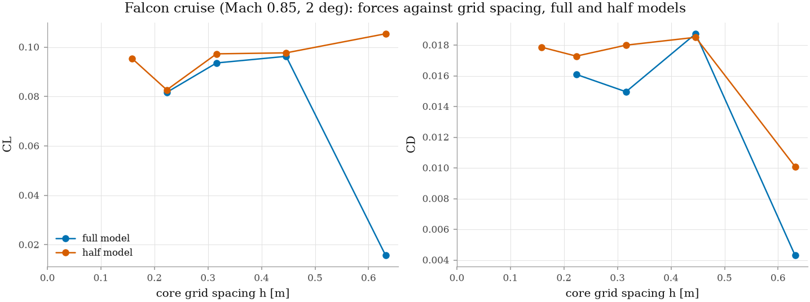

# Baseline results

What the existing implementation actually produces, reproduced on 2026-11-11. Registry IDs refer to
`EXPERIMENT_REGISTRY.csv`. Labels: **[observed]** measured; **[derived]** computed from observed numbers;
**[hypothesis]** not yet tested.

## 1. Whole-design shape optimisation (NACA 2412, CMA-ES)

### 1.1 Search (SO-2026-11-07-std, record rebuilt from per-seed results)

| Run | Evaluations | Search hold-out J | Feasible on search hold-out |
|---|---|---|---|
| CMA-ES seed 0 | 12,016 | 0.9254 | no (best round infeasible) |
| **CMA-ES seed 1** | 12,032 | **0.9250** | **yes** (reported design) |
| CMA-ES seed 2 | 9,600 | 0.9256 | no |
| DE seed 7 (control) | 14,400 | 0.9290 | not recorded |
| Baseline | - | 1.0000 | yes |

The three CMA-ES seeds agree within 0.0006, and CMA-ES beats DE on the same budget. **[observed]**

The quick profile (SO-2026-11-09-quick, 480 evaluations per seed) reached 1.028 at best, **worse than the
baseline**. **[observed]**

### 1.2 Independent test hold-out (SO-2026-11-11-reverify; 300 2D + 60 3D states, NeuralFoil "xxxlarge")

| Quantity | Standard design | Quick design | Baseline |
|---|---|---|---|
| Unpenalised J0 | **0.9344** (reproduced exactly from 2026-11-07) | 0.9608 | 1.0000 |
| J2D / J3D | 0.979 / 0.889 | 0.991 / 0.931 | 1 / 1 |
| Violated constraints | surrogate confidence +0.43 | surrogate confidence +0.86 | none |
| Penalised J | 9.16 | 32.18 | 1.00 |
| 2D drag ratio, all 311 states: mean / median / CVaR90 / worst | 0.935 / 0.941 / 1.024 / 1.128 | 0.955 / 0.960 / 1.027 / 1.065 | 1 |
| Share of 2D states improved | 93 % | 87 % | - |
| 3D drag ratio, 67 flight states: mean / worst | 0.837 / 0.957 (all improved) | - | 1 |

### 1.3 Where the surrogate is trusted (new analysis, `scripts/shapeopt_trust_split.py`)

The confidence floor of the problem is 0.70 (baseline minimum 0.773). **[observed]**

| | Standard design | Quick design |
|---|---|---|
| 2D test states below the floor | 1 of 311 (`random_198`, Re 1.8e7, Mach 0.55; design only) | 2 of 311 (design only) |
| 3D table rows below the floor | 1 of 1,273 (contaminated cruise at -3 deg) | 6 of 1,273 |
| 2D mean drag ratio on trusted states only | **0.934** (310 states) | 0.954 (309 states) |

**Conclusion [derived]:** the standard design's gain does not come from states where NeuralFoil distrusts itself:
restricted to trusted states the 2D drag falls by 6.6 % and 93 % of states improve. It is classed infeasible
because the constraint takes the minimum confidence over 1,584 evaluations and two of them fall below 0.70.
This is a statement about the surrogate's coverage at two off-design points, not evidence that the gain is
spurious. Independent evidence remains limited to XFOIL (254 of 311 states, mean ratio 0.930; KI-16), which is not
fully independent because NeuralFoil was trained on XFOIL data, and to the panel + boundary-layer solver, which
agrees on maximum lift (below).

### 1.4 What the design actually is

| | Baseline | Standard design | Bound |
|---|---|---|---|
| Wing area | 16.2 m2 | 15.26 m2 | 11-26 |
| Aspect ratio | 7.5 | **15.99** | **16 (upper bound)** |
| Taper | 1.0 | **0.300** | **0.30 (lower bound)** |
| Tip twist | 0 deg | -1.68 deg | -8 to 2 |
| Wing mass (model) | 155 kg | 228 kg (+47 %) | - |
| Flutter speed | 251 m/s | 206 m/s | required > 101 m/s (1.2 x V_D) |
| Divergence speed | 388 m/s | 334 m/s | required > 101 m/s |
| Stall speed | 26.85 m/s | 26.80 m/s | must not rise |
| Section c_l,max (panel + boundary layer, Re 6e6) | 1.800 | 1.804 | - |

**[observed]** Two of the six planform variables sit on their bounds. The 3D gain (16 % drag) is mostly induced
drag removed by the very high aspect ratio, paid for with wing mass; the answer is set by the chosen bounds and by
the structural-mass model, not by an interior optimum. A multi-objective formulation (drag against wing mass and
flutter margin) would show this trade-off instead of folding it into one score (roadmap R-5).

## 2. 3D CFD (aeroflow)

| ID | Case | Cells (wall cells) | Steps | C_L | C_D | Time |
|---|---|---|---|---|---|---|
| CFD-2026-11-09-falcon-std | Falcon cruise, full model, standard | 331,240 | 2,500 | 0.0880 | 0.0143 | 2,726 s |
| CFD-2026-11-10-speed-a | same, draft, every step | 132,600 (124 + 130) | 2,400 | 0.04351 | 0.01072 | 882 s |
| CFD-2026-11-10-speed-b | draft, stop on settled mean forces | 132,600 | 1,420 | 0.04348 | 0.01073 | 477 s |
| CFD-2026-11-10-speed-c | draft, coarse pass first | 132,600 + 44,660 | 1,370 + 800 | 0.04352 | 0.01073 | 859 s |
| OPT run 00 (half model) | draft, half model | 67,600 (48 + 60) | 1,430 | 0.0681 | 0.0296 | 347 s |

### 2.1 Mesh study (R-3, 2026-11-11, `results/cfd_mesh_study/falcon_cruise_2026-11-11`)

Falcon cruise, Mach 0.85, 2 deg, 11 km; every run stopped on settled window-mean forces (all 8 did, 1,410 to 1,890
steps). Core grid spacing h = 15.16 m / cells per length. **[measured]**

| Model | Cells per length | Cells | Wall cells | C_L | C_D | s per step | Peak memory |
|---|---|---|---|---|---|---|---|
| full | 24 | 90,720 | 32 | 0.01573 | 0.00431 | 0.24 | 36 MB |
| full | 34 | 173,376 | 92 | 0.09627 | 0.01874 | 0.44 | 64 MB |
| full | 48 | 342,433 | 511 | 0.09358 | 0.01496 | 1.07 | 121 MB |
| full | 68 | 685,440 | 1,472 | 0.08169 | 0.01609 | 2.67 | 232 MB |
| half | 24 | 46,368 | 15 | 0.10540 | 0.01009 | 0.11 | 21 MB |
| half | 34 | 86,688 | 46 | 0.09768 | 0.01851 | 0.26 | 35 MB |
| half | 48 | 173,628 | 291 | 0.09728 | 0.01799 | 0.53 | 65 MB |
| half | 68 | 342,720 | 767 | 0.08269 | 0.01728 | 0.87 | 122 MB |
| half | 96 | 740,745 | 2,169 | 0.09541 | 0.01786 | 3.52 | 252 MB |

* **Not grid-converged** **[measured]** (KI-77). On the three finest grids (34, 48, 68) C_L changes more between 48
  and 68 (-13 % full, -15 % half) than between 34 and 48 (-3 %, -0.4 %): Celik's R = e21/e32 is 4.4 (full C_L), 36.7
  (half C_L) and 1.4 (half C_D), so the grids are not in the asymptotic range and no order, extrapolated value or GCI
  can be given. Full-model C_D oscillates (0.0187, 0.0150, 0.0161). The finest-grid forces are the best estimate,
  with an uncertainty of at least the last change (C_L about 0.08 +- 0.01).
* **Half and full models agree once the grid resolves the wings** **[measured]** (KI-68 explained): C_L ratio 1.015,
  1.039, 1.012 at 34, 48, 68 cells per length (6.7 at 24); C_D ratio 0.99, 1.20, 1.07. The half model costs a third
  of the time per step, so it is the economical model for the next, finer grid.
* **Coarse grids are badly wrong** **[measured]**: at 24 cells per length C_L is 0.016 (full) or 0.105 (half)
  against about 0.08 on the finest grid. The draft quality (30 cells per length) gave 0.0435. Draft forces are for
  setting up a case, not for design decisions.
* **Memory** **[measured]**: about 0.34 kB per cell (232 MB at 685,000 cells), so the 32-bit solver's 2 GB limit
  allows about 5 million cells.

The 96-cell run (old solver, added 2026-11-11) confirms the oscillation: half-model C_L 0.0973, 0.0827, 0.0954 on 48,
68, 96. Section 2.2 shows that most of it came from the thin-surface treatment, not the grid.

### 2.2 Immersed-boundary fixes (2026-11-11): lift against the vortex lattice

**Thickness study** (`scripts/cfd_thickness_study.py`, `results/cfd_lift_study/`): rectangular wing, AR 6, NACA
00xx, inviscid, Mach 0.5, 4 deg; ratio of C_L to the vortex lattice (8 x 24 panels, C_L 0.328). **[measured]**

| t/c | old solver, 12 cells per chord | sealed (KI-78/79), 12 | face walls (KI-80), 12 | face walls, 18 | face walls, 24 | lattice x (1 + 0.8 t/c) |
|---|---|---|---|---|---|---|
| 0.02 | 0.000 | 0.956 | 1.022 | 0.941 | 1.060 | 1.016 |
| 0.06 | 0.919 | 0.919 | 0.919 | - | - | 1.048 |
| 0.10 | 0.731 | 1.012 | 0.979 | 1.037 | 1.069 | 1.080 |
| 0.15 | 0.570 | 0.777 | 0.745 | 0.868 | 1.113 | 1.120 |
| 0.20 | 1.031 | 1.033 | 1.031 | - | - | 1.160 |

On 24 cells per chord all three thicknesses are within 4 % of the thickness-corrected lattice. The low t/c 0.15 values
on 12 cells per chord are resolution (1.8 cells across the section), not a defect: they rise with the grid. The
correction factor 1 + 0.8 t/c is an approximation of thin-aerofoil theory, not a measured reference. **[derived]**

**Falcon cruise, half model** (Mach 0.85, 2 deg, 11 km; every run settled within 0.5 % over its last window).
**[measured]**

| Solver | 34 | 48 | 68 | 96 cells per length | C_L spread |
|---|---|---|---|---|---|
| old (before 2026-11-11) | 0.0977 | 0.0973 | 0.0827 | 0.0954 | 15 % |
| sealed, sheet cells (KI-78/79 only) | 0.1498 | 0.0730 | 0.1386 | - | 51 % |
| **face walls + friction fix (current)** | **0.1403** | **0.1440** | **0.1425** | **0.1167** | **19 %** (2.6 % on 34-68) |
| C_D, current | 0.0187 | 0.0191 | 0.0169 | 0.0160 | monotonic on 48-96 |

Spread is (largest - smallest) / largest. The 96-cell run (current solver, 740,745 cells, 4,136 s, 252 MB, settled
over its last 600 steps) changes the picture **[measured]**: **drag converges** on 48, 68, 96 (order 2.7, extrapolated
C_D 0.0154, fine-grid GCI 4.4 %), but **lift does not**: it falls 18 % from 68 to 96, a divergent triple (R = 17.7).

**Where the lift goes** (KI-84; converged fields reloaded into a debug build that writes every wall element's force).
Sectional lift c_l c per span strip **[measured]**:

| Strip (y, m) | 68: held by | 68: c_l c | 96: held by | 96: c_l c |
|---|---|---|---|---|
| 0.5-1.0 (wing root) | face walls | 0.51-0.62 | thin + ghost cells | 0.46-0.49 |
| 1.2-2.3 | face walls only | 0.52-0.56 | face walls (1.6-2.1) | 0.47 |
| 3.0-3.9 | thin cells + face walls | 0.20-0.34 (walls -0.13 to -0.22) | thin cells + face walls | 0.24-0.27 (walls -0.11 to -0.20) |

Where a strip holds both, the face walls at the leading edge carry negative lift ahead of a row of thin cells: the row
is a solid step one cell high facing the oncoming air **[observed]**. Two solver changes were tried in scratch builds
and **not adopted**: ghost back faces never triggered; turning thin cells into face walls fixes the sheet case on 18
cells per chord (0.941 to 1.050 of the lattice) but breaks the 15 % wing on 24 (1.113 to 0.83-0.89) **[measured]**.

The vortex lattice gives C_L 0.157 for this flight (12 x 36 panels; 0.202, 0.156, 0.170, 0.160 on coarser panelling);
it has flat lifting surfaces and only a Prandtl-Glauert correction at Mach 0.85, so the 9 % difference on 34-68 is
within its own uncertainty; the 26 % on 96 is not. **[derived]**

**Verification with the current solver** (`results/cfd_verification_facewall_2026-11-11`; the 2026-11-07 set is kept).
**[measured]**

| Case | 2026-11-07 | current |
|---|---|---|
| Spheroid C_D (24 / 40 cells per length) | 0.00223 / 0.00045 | identical |
| Delta wing C_L at 10 / 20 deg | 0.350 / 0.686 | identical |
| Cone (Mach 2) surface C_p, Taylor-Maccoll 0.1045 | 0.0974 (std 0.0043) | 0.1025 (std 0.0015) |
| Flat plate friction / Karman-Schoenherr | 0.64 | 0.61 (0.26 with the 2026-11-10 solver, KI-81) |
| AR 6 2 % wing C_L / lattice | 0.72 (14.4 cells per chord) | 1.10 (24 cells per chord, KI-83) |

No 3D result has been compared with wind-tunnel data. **On the Falcon, 3D drag converges from 48 cells per length
(GCI 4.4 % on 96); lift does not (19 % spread on 34-96, KI-77, KI-84). Compare wings on one grid and confirm the best
on a finer one.**

## 3. Tests

The last full test run of record (2026-11-08) was cut off before its totals, with 8 failures listed (see
`PROJECT_AUDIT.md` section 7). The suites touched by this audit were re-run on 2026-11-11 (section 4).

## 4. Re-run of affected tests (2026-11-11)

`tests/test_shapeopt.py`, `tests/test_optimise_and_flowviz.py`, `tests/test_turbulence_and_setup.py`: 43 passed,
then 1 more after adding `test_pick_best_prefers_feasible_designs` (KI-69). **[observed]** The full suite has not
been re-run (roadmap R-8).
